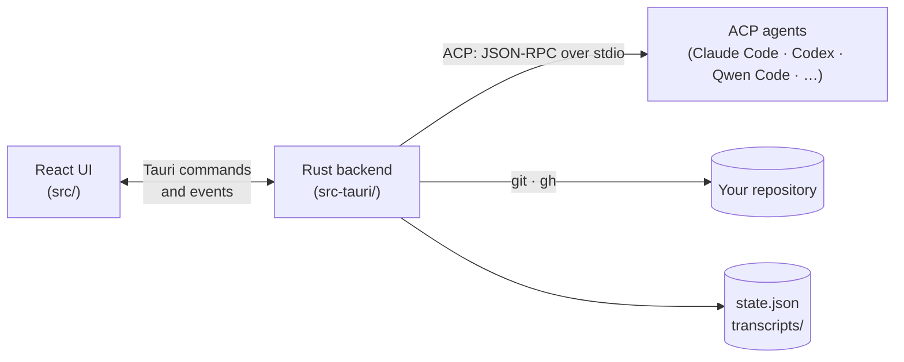

# Zorvo

[](https://github.com/zakyirsyaad/zorvo/actions/workflows/ci.yml)
[](https://github.com/zakyirsyaad/zorvo/actions/workflows/security.yml)
[](https://github.com/zakyirsyaad/zorvo-releases/releases)


**Every coding agent. One desktop.**

A desktop app for the coding agents you already use. Claude Code, Codex,
Qwen Code, Gemini CLI and the other agents in the
[ACP registry](https://agentclientprotocol.com) run in a real chat UI. It is
like Claude Code Desktop, but for whichever agent you have.

- [User guide](#user-guide)
- [How it works](#how-it-works)
- [Development](#development)
- [Releasing](#releasing)
- [Roadmap](#roadmap)
- [License](#license)

## User guide

The guide for people who use Zorvo (features, supported agents,
requirements, install, privacy, troubleshooting) is
[`docs/releases-repo/README.md`](docs/releases-repo/README.md). Each release
publishes that file as the README of the
[zorvo-releases](https://github.com/zakyirsyaad/zorvo-releases) repository,
next to the downloads. Change user-facing documentation there.

## How it works



- **The frontend** (`src/`, React 19 and Tailwind). Every session
  is an ACP chat, run by `hooks/session-engine/useAcpEngine.ts`.
- **The backend** (`src-tauri/src/`, Tauri 2):
  - `acp/`: the ACP client;
  - `pty_session.rs` and `workspace_terminal.rs`: the terminals an agent's own
    sign-in and the workspace shells run in;
  - `registry/`: the ACP agent registry, its dated version history and the
    agents you use;
  - `installer/`: installing agents, Node.js and `uv`, every download checked
    against a pinned hash;
  - `app_update.rs`: Zorvo's own updates, checked against `latest.json` in
    zorvo-releases and verified with the updater public key;
  - `profiles.rs`: the agent profiles and how agents are found;
  - `store.rs`: state and transcripts;
  - `changes.rs`, `worktrees.rs` and `branches.rs`: git;
  - `pull_requests.rs`: `gh`.

## Development

```bash
pnpm install
pnpm tauri dev
```

| Check | Command |
|---|---|
| Types and ESLint | `pnpm lint` |
| Frontend tests | `pnpm test` |
| Rust tests | `cd src-tauri && cargo test` |
| Rust lint | `cd src-tauri && cargo clippy --all-targets -- -D warnings` |
| Production build | `pnpm tauri build` |
| Refresh the bundled registry history | `pnpm registry:update` |

To run the fast checks before each commit (types, ESLint, `cargo fmt`), opt in
with `pnpm lefthook install`.

On every pull request, CI runs the types, ESLint and the frontend tests. The
Rust lint and tests run on a macOS runner, so they run on every push to `main`
and on a pull request only when it changes `src-tauri/` or the build inputs.
CI also runs a dependency audit (`pnpm audit`, `cargo audit`), and Dependabot
proposes updates weekly.

CI does not build the release bundle. Before a release, run
`pnpm tauri build` and open the app: the production build is the only one that
applies the Content Security Policy. A build also signs the update package, so
it needs the updater key in the environment; to build without it, add
`--config '{"bundle":{"createUpdaterArtifacts":false}}'` (see
[Releasing](#releasing)).

See [CONTRIBUTING.md](CONTRIBUTING.md) for how to propose a change,
[SECURITY.md](SECURITY.md) for how to report a vulnerability, and
[CHANGELOG.md](CHANGELOG.md) for what changed in each release.

## Releasing

1. Bump the version in `package.json`, `src-tauri/Cargo.toml` and
   `src-tauri/tauri.conf.json`. In `CHANGELOG.md`, rename `Unreleased` to the
   new version with its release date, add its compare link, and start a new
   empty `Unreleased` section.
2. Tag and push: `git tag vX.Y.Z && git push origin vX.Y.Z`. The workflow
   stops before it builds if the tag is not `vMAJOR.MINOR.PATCH` (or
   `vMAJOR.MINOR.PATCH-rc.1`), does not match the version in those three
   files, or has no section in `CHANGELOG.md`.
3. The **Release** workflow builds a universal macOS app and keeps the DMG and
   the update package as a workflow artifact for 30 days. It holds no secret of
   the release and publishes nothing (see "Why signing happens on your Mac").
4. When the run is green, sign and publish the draft from your Mac, in a clean
   checkout of the tag:

   ```bash
   git fetch --tags
   git switch --detach vX.Y.Z
   node scripts/sign-release.mjs vX.Y.Z
   ```

   Run it with `node`, not as a package script: `pnpm run` puts the project's
   `node_modules/.bin` first on PATH. The script proves that HEAD, the tag on
   GitHub and the commit the run built are the same, then downloads the
   artifact from that run with your own `gh` login (which needs access to this
   repository and to
   [zorvo-releases](https://github.com/zakyirsyaad/zorvo-releases)) and checks
   it. A download that breaks halfway (a reset connection, a timeout, a server
   error) is tried again on its own, up to three tries in all; any other
   failure stops it. It shows what changed since the last release in the dependencies, the
   workflow and the scripts, and asks you to go on. Then it asks for the key's
   password (typed hidden, and never read from the environment), signs the
   update package, and makes a draft release in zorvo-releases, the repository
   installed copies update from. The draft gets
   the release notes from the version's changelog section, the DMG (also as
   `Zorvo-mac.dmg`, the name the site's Download link uses), `SHA256SUMS.txt`,
   the update package with its `.sig`, and `latest.json`. The script also
   copies `docs/releases-repo/` (the user guide, issue forms and security
   policy, as git tracks them) and the released part of `CHANGELOG.md` there.
   `--dry-run` does everything except write to GitHub. The key is read from
   `~/.tauri/zorvo-updater.key`; use `--key <path>` or
   `TAURI_SIGNING_PRIVATE_KEY_PATH` if it is elsewhere. If it stops partway,
   run it again: it fills the same draft.
5. Publish the draft when it looks right: releases there are immutable once
   published. Publishing is what makes it the "latest" release installed
   copies see; a tag with a pre-release part (`v0.7.0-rc.1`) makes a
   pre-release, which never is.

### Why signing happens on your Mac

Every installed Zorvo trusts one updater key and installs whatever it signs, so
whoever can read the private key can push an update to all of them. The
workflow runs the project's own dependencies (Vite, every crate's `build.rs`,
all dev-dependency code), and any repository secret can also be read by any
workflow in the repository, a changed one on a branch included. So the updater
key, its password and a token that can publish to zorvo-releases are not in
GitHub at all, and no GitHub secret by those names should exist. The workflow
needs only the optional Apple ones.

To sign and notarize the app, so Gatekeeper opens it without a warning, add
these repository secrets from an Apple Developer account. They stay repository
secrets because the app is signed and notarized while it is built, so, unlike
the updater key, they reach the build job:

- `APPLE_CERTIFICATE` (a base64 `.p12`)
- `APPLE_CERTIFICATE_PASSWORD`
- `APPLE_SIGNING_IDENTITY`
- `APPLE_ID`
- `APPLE_PASSWORD` (an app-specific password)
- `APPLE_TEAM_ID`

Without them, the build is unsigned.

### The updater key

Make it once, on your own machine (not the Apple key):

```bash
pnpm tauri signer generate -w ~/.tauri/zorvo-updater.key
```

Put the **public** key it prints in `plugins.updater.pubkey` in
`src-tauri/tauri.conf.json`. The private key stays in that file. To check, on
your machine, that the password is right and the key is the one that belongs to
the public key (the Tauri CLI only warns about that last case), run this (zsh,
the macOS default; the password is typed hidden):

```bash
read -rs "pw?Updater key password> " && echo && TAURI_SIGNING_PRIVATE_KEY="$(cat ~/.tauri/zorvo-updater.key)" TAURI_SIGNING_PRIVATE_KEY_PASSWORD="$pw" node scripts/check-updater-signing.mjs key src-tauri/tauri.conf.json; unset pw
```

Back the private key up somewhere safe: a build signed with another key is
refused by every Zorvo already installed, so losing it means those installs can
never update themselves again.

### How `scripts/sign-release.mjs` signs

Installed copies require the update's signature to record the version it was
made for (`requireSignedVersion`), and `tauri signer sign` without
`--app-version` does not, so releases are signed by the script, never by hand.
It uses the Tauri CLI pinned in `scripts/updater-signer` (the root lockfile's
version, which a test keeps equal), installed every time with
`npm ci --ignore-scripts` and run by `node` itself, so none of the project's
dependencies run next to the key's password and no PATH lookup decides which
program gets it. It hands the CLI the key's path and never reads the file, and
the password goes only into the CLI's own environment. It also drops the
project's folders from PATH, and the key's variables from the environment of
everything else it starts. `node scripts/check-updater-signing.mjs key
src-tauri/tauri.conf.json` checks a key the same way, with the pinned CLI.

Before it signs it checks that nothing changed in the checkout (tracked files
only), that HEAD is the commit the tag has on GitHub and the commit the newest
successful run built, and that the build is data it can accept: exactly the DMG
and the package, a package that holds only `Zorvo.app` (no hard links, no links
out of it), and an app that holds the public key of `tauri.conf.json` as text,
so a build cannot quietly ship an app that trusts another key. The checkout is
read once at the start and checked again before it signs and before it
uploads. After signing, and before it touches GitHub, it writes `latest.json`
and checks it (`check-updater-signing.mjs manifest`): it lists both
`darwin-aarch64` and `darwin-x86_64`, every download URL is inside the releases
repository, and every signature is the public key's, verifies the update
package and records this release's version.

The build job is given a one-off key made on the runner, because `tauri build`
refuses to run without a key while update packages are on and `--no-sign` would
also turn off Apple code signing; the signature it makes is thrown away. A
local `pnpm tauri build` signs the update package too, so it needs
`TAURI_SIGNING_PRIVATE_KEY` (and the password) in the environment; add
`--config '{"bundle":{"createUpdaterArtifacts":false}}'` to build without them.

### What this does not protect against

- **A build that is compromised during a release you sign.** The build job runs
  the project's dependencies, and what it makes is signed. The checks above are
  a sanity check and a tripwire, not a boundary. The list of changes the script
  shows before it asks is there for this: read the lockfile changes.
- **The DMG.** Only the package is signed by your key and checked for the app
  inside. The DMG, which new installs and the site's Download link use, is as
  trustworthy as the build; `SHA256SUMS.txt` is made from the same file. With
  the Apple secrets set, the DMG is signed and notarized, which a person can
  check with `spctl`.
- **Other code running as you on your Mac.** The project's dependencies also run
  there (`pnpm test`, `pnpm tauri dev`), as you, and could read
  `~/.tauri/zorvo-updater.key`. Only the password protects the key then. Keep
  the password strong, and keep the file at mode 600 (the script warns if it
  is not).
- **A tag moved by someone with push access.** The script would run that tag's
  code. Read what changed (the list above includes `scripts` and `.github`).

## Roadmap

- A signed and notarized build, so macOS opens it without a warning.
- Windows and Linux builds.
- Undoing an agent's file changes along with a rewind.
- End-to-end tests of the built app.

## License

Zorvo is licensed under the [Apache License 2.0](LICENSE). The license does not
cover the Zorvo name or logo.
