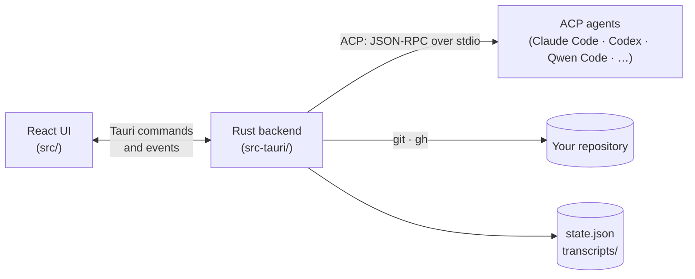

# Zorvo

[](https://github.com/zakyirsyaad/zorvo/actions/workflows/ci.yml)
[](https://github.com/zakyirsyaad/zorvo/actions/workflows/security.yml)
[](https://github.com/zakyirsyaad/zorvo-releases/releases)


**Every coding agent. One desktop.**

A desktop app for the coding agents you already use. Claude Code, Codex,
Qwen Code, Gemini CLI and the other agents in the
[ACP registry](https://agentclientprotocol.com) run in a real chat UI. It is
like Claude Code Desktop, but for whichever agent you have.

- [User guide](#user-guide)
- [How it works](#how-it-works)
- [Development](#development)
- [Releasing](#releasing)
- [Roadmap](#roadmap)
- [License](#license)

## User guide

The guide for people who use Zorvo (features, supported agents,
requirements, install, privacy, troubleshooting) is
[`docs/releases-repo/README.md`](docs/releases-repo/README.md). This repository
is private, so the Release workflow publishes that file as the README of the
public [zorvo-releases](https://github.com/zakyirsyaad/zorvo-releases)
repository, next to the downloads. Change user-facing documentation there.

## How it works



- **The frontend** (`src/`, React 19 and Tailwind). Every session
  is an ACP chat, run by `hooks/session-engine/useAcpEngine.ts`.
- **The backend** (`src-tauri/src/`, Tauri 2):
  - `acp/`: the ACP client;
  - `pty_session.rs` and `workspace_terminal.rs`: the terminals an agent's own
    sign-in and the workspace shells run in;
  - `registry/`: the ACP agent registry, its dated version history and the
    agents you use;
  - `installer/`: installing agents, Node.js and `uv`, every download checked
    against a pinned hash;
  - `app_update.rs`: Zorvo's own updates, checked against `latest.json` in
    zorvo-releases and verified with the updater public key;
  - `profiles.rs`: the agent profiles and how agents are found;
  - `store.rs`: state and transcripts;
  - `changes.rs`, `worktrees.rs` and `branches.rs`: git;
  - `pull_requests.rs`: `gh`.

## Development

```bash
pnpm install
pnpm tauri dev
```

| Check | Command |
|---|---|
| Types and ESLint | `pnpm lint` |
| Frontend tests | `pnpm test` |
| Rust tests | `cd src-tauri && cargo test` |
| Rust lint | `cd src-tauri && cargo clippy --all-targets -- -D warnings` |
| Production build | `pnpm tauri build` |
| Refresh the bundled registry history | `pnpm registry:update` |

To run the fast checks before each commit (types, ESLint, `cargo fmt`), opt in
with `pnpm lefthook install`.

On every pull request, CI runs the types, ESLint and the frontend tests. The
Rust lint and tests run on a macOS runner, so they run on every push to `main`
and on a pull request only when it changes `src-tauri/` or the build inputs.
CI also runs a dependency audit (`pnpm audit`, `cargo audit`), and Dependabot
proposes updates weekly.

CI does not build the release bundle. Before a release, run
`pnpm tauri build` and open the app: the production build is the only one that
applies the Content Security Policy. A build also signs the update package, so
it needs the updater key in the environment; to build without it, add
`--config '{"bundle":{"createUpdaterArtifacts":false}}'` (see
[Releasing](#releasing)).

See [CONTRIBUTING.md](CONTRIBUTING.md) for how to propose a change,
[SECURITY.md](SECURITY.md) for how to report a vulnerability, and
[CHANGELOG.md](CHANGELOG.md) for what changed in each release.

## Releasing

1. Bump the version in `package.json`, `src-tauri/Cargo.toml` and
   `src-tauri/tauri.conf.json`. In `CHANGELOG.md`, rename `Unreleased` to the
   new version with its release date, add its compare link, and start a new
   empty `Unreleased` section.
2. Tag and push: `git tag vX.Y.Z && git push origin vX.Y.Z`. The workflow
   stops before it builds if the tag is not `vMAJOR.MINOR.PATCH` (or
   `vMAJOR.MINOR.PATCH-rc.1`) or does not match the version in those three
   files.
3. The **Release** workflow builds a universal macOS app and attaches it to a
   draft release in the public
   [zorvo-releases](https://github.com/zakyirsyaad/zorvo-releases) repository
   (this one is private, so its releases cannot be downloaded). It writes the
   release notes from the version's changelog section, uploads the DMG again
   as `Zorvo-mac.dmg` (the name the site's Download link uses) with a
   `SHA256SUMS.txt`, and copies `docs/releases-repo/` (the user guide, issue
   forms and security policy) and the released part of `CHANGELOG.md` there.
   Publish the draft when it looks right: releases there are immutable once
   published.

The workflow needs the `RELEASES_TOKEN` secret: a fine-grained personal access
token with **Contents: Read and write** on `zorvo-releases` only.

To sign and notarize the app, so Gatekeeper opens it without a warning, add
these repository secrets from an Apple Developer account:

- `APPLE_CERTIFICATE` (a base64 `.p12`)
- `APPLE_CERTIFICATE_PASSWORD`
- `APPLE_SIGNING_IDENTITY`
- `APPLE_ID`
- `APPLE_PASSWORD` (an app-specific password)
- `APPLE_TEAM_ID`

Without them, the build is unsigned.

Zorvo updates itself from these releases, so every release must also be signed
with the updater key (not the Apple one). Make it once, on your own machine:

```bash
pnpm tauri signer generate -w ~/.tauri/zorvo-updater.key
```

Put the **public** key it prints in `plugins.updater.pubkey` in
`src-tauri/tauri.conf.json`, and add the **private** key and its password as the
repository secrets `TAURI_SIGNING_PRIVATE_KEY` and
`TAURI_SIGNING_PRIVATE_KEY_PASSWORD`. Before it builds, the workflow signs a
test file with them (`scripts/check-updater-signing.mjs key`) and stops if a
secret is missing, the password is wrong or the key is not the one that belongs
to the public key: the Tauri CLI only warns about that last case and reports a
wrong password after the whole build. To run the same check on your machine
before you tag (zsh, the macOS default; the password is typed hidden):

```bash
read -rs "pw?Updater key password> " && echo && TAURI_SIGNING_PRIVATE_KEY="$(cat ~/.tauri/zorvo-updater.key)" TAURI_SIGNING_PRIVATE_KEY_PASSWORD="$pw" node scripts/check-updater-signing.mjs key src-tauri/tauri.conf.json; unset pw
```

Back the private key up somewhere safe: a build signed with another key is
refused by every Zorvo already installed, so losing it means those installs can
never update themselves again.

Releases are signed by `tauri build`, which the workflow runs, never by hand:
installed copies require the update's signature to record the version it was
made for (`requireSignedVersion`), and `tauri signer sign` without
`--app-version` does not.

The workflow also uploads `latest.json`, the `.app.tar.gz` and its `.sig`, and
then checks `latest.json` (`check-updater-signing.mjs manifest`): it lists both
`darwin-aarch64` and `darwin-x86_64`, every download URL is inside the releases
repository, and every signature is the public key's and records this release's
version. Publishing the draft is what makes it the "latest" release installed
copies see; a tag with a pre-release part (`v0.7.0-rc.1`) is made a
pre-release, which never is. A local `pnpm tauri build` signs the update
package too, so it needs `TAURI_SIGNING_PRIVATE_KEY` (and the password) in the
environment; add `--config '{"bundle":{"createUpdaterArtifacts":false}}'` to
build without them.

## Roadmap

- A signed and notarized build, so macOS opens it without a warning.
- Windows and Linux builds.
- Undoing an agent's file changes along with a rewind.
- End-to-end tests of the built app.

## License

No license has been granted yet, so all rights are reserved by the author.
