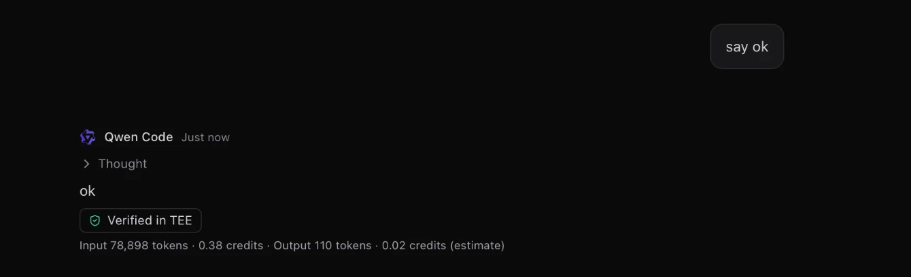
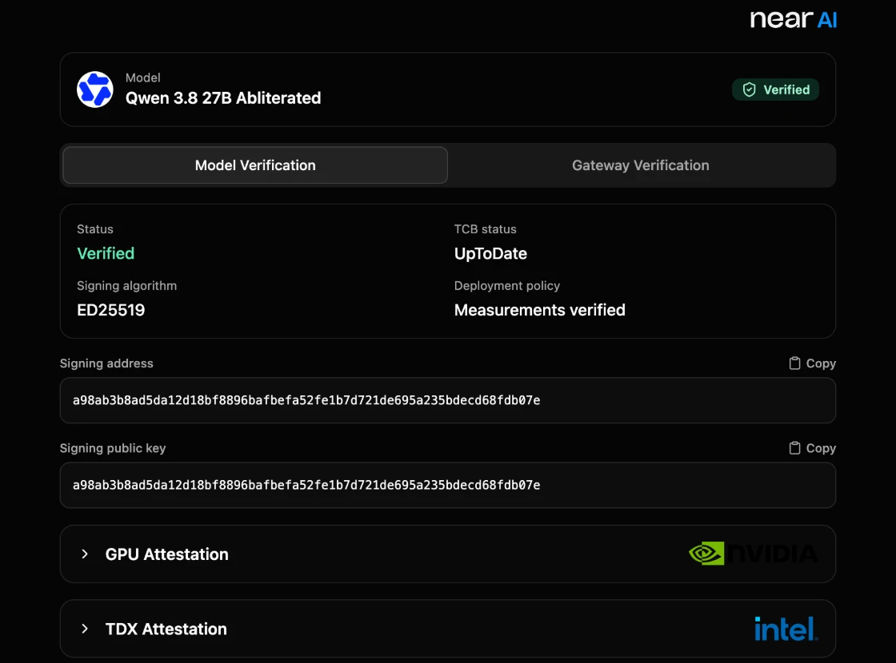
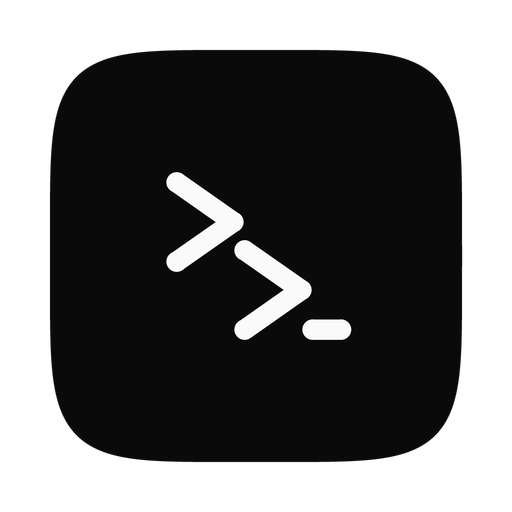

# NEAR HACKATHON: Zorvo Private

Tracks: `privacy` (primary), `security`, `open`, `agents`. Branch: `hackathon/near-credits`.

Zorvo Private is an opt-in private mode in Zorvo, an open-source macOS app that hosts coding agents over
the Agent Client Protocol (ACP). In Private mode Qwen Code runs only on NEAR AI Cloud models that run
inside a TEE (Intel TDX with NVIDIA confidential computing), not on the user's own account or an
ordinary cloud endpoint. The user pays with prepaid credits bought with USDC through PingPay. There is no
sign-up, wallet or email: the balance belongs to the Mac, and a recovery code moves it to another Mac.



_A private reply on 2026-11-14: NEAR AI's signature checked, and what the reply used._



_The badge's link opens NEAR AI's Verification Center on the session's model: the hardware check Zorvo does not run itself._

## Role of NEAR

- **Private compute.** Models run in NEAR AI Cloud TEEs (Intel TDX + NVIDIA confidential computing). The
  app offers only models NEAR AI marks `verifiable: true`; a model that stops being verifiable leaves the
  list, and a private session is never silently continued on a non-TEE provider.
- **Signed answers.** Each private answer is checked against NEAR AI's signature over the exact request
  and response bytes, and the signer is checked against NEAR AI's attestation report. Zorvo does **not**
  do a DCAP or NRAS hardware check; it verifies the signature and the report's signer address, and links
  to NEAR AI's Verification Center for the hardware proof itself. A streamed answer is usually signed by
  NEAR AI's gateway rather than the model's provider key.
- **The key stays local after handover.** The Credits Worker creates one NEAR AI key per Mac and stores it
  encrypted for at most 24 hours, until the app collects it; after that the app keeps it in the macOS
  Keychain, and a loopback proxy in Zorvo's Rust backend adds it to each request. Qwen Code only ever holds
  a one-time proxy token. The Worker never sees prompts or completions. A capped session's key is created
  the same way, handed to the app once, and not stored by the Worker.
- **USDC on NEAR.** Payments are USDC on NEAR through PingPay, which is built on NEAR Intents. Zorvo
  creates a checkout on the Credits Worker and opens it in the browser; no card or wallet data reaches
  Zorvo. The checkout return URLs in `server/wrangler.jsonc` point at this branch's `server/README.md`, so
  a redeploy follows a branch rename.
- **Spend-limited keys.** The Worker creates one NEAR AI key per Mac with a spend limit, and the
  per-session cap creates a second key with its own limit. NEAR AI's gateway enforces both (`402`), so a
  cap holds even if Zorvo is closed.
- **Operator login.** The operator signs in to NEAR AI with NEP-413 through
  `server/scripts/operator-login.mjs`; the operator's full-access NEAR key stays on the operator's Mac.

## Tracks

- **`privacy` (primary).** Prompts go from the agent to NEAR AI through the local proxy; the Credits
  Worker never sees a prompt or a completion. It creates the Mac's NEAR AI key and hands it over once, as
  described above; after collection the key lives in the macOS Keychain, not in the Worker. Nothing
  prompt-shaped is kept server-side: the Worker stores no prompts or completions, and the loopback proxy
  keeps only completion ids and SHA-256 hashes in memory for the app run.
- **`security`.** Every completed private answer is checked against NEAR AI's signature over the exact
  request and response bytes, and its signer against NEAR AI's attestation report. Zorvo does not run a
  DCAP or NRAS hardware check; it verifies the signature and the report's signer address and links to
  NEAR AI's Verification Center for the hardware proof. The NEAR AI key never enters Qwen Code's process:
  a loopback proxy in Zorvo's Rust backend holds it and adds it to each request, while the agent holds
  only a per-launch proxy token. Spending caps are enforced by NEAR AI's gateway (`402`), not by Zorvo,
  and the device key's limit is kept at what the Mac bought minus its open caps and spent credits, so the
  device's total can never pass what it bought. Before a private message leaves, a local secret check
  looks for keys and passwords in its text and attachments and pauses Send until you choose; nothing it
  finds is stored or sent.
- **`open`.** Zorvo and the Credits Worker are in this Apache-2.0 repository. The Worker is a plain
  Cloudflare Worker with one SQLite Durable Object; its contract, operator setup and deploy steps are in
  [`server/README.md`](server/README.md). Outside Private mode, no API keys are stored in the app; Private
  mode keeps its keys in the macOS Keychain.
- **`agents`.** A coding agent spends prepaid credits on private compute through its own spend-limited
  NEAR AI key. The key's limit is enforced by NEAR AI's gateway (`402`), and a session can also carry a
  100, 200 or 500-credit cap of its own. An MCP server inside the app lets the agent read its balance and
  the model prices; it never sees the key or the device secret. It can also ask the user for a top-up,
  with one short reason: the card shows the Worker's package and credits, and only the user's click
  starts their own PingPay checkout. Payment is USDC on NEAR through PingPay (NEAR Intents).

## Reproduce

### (a) No Mac needed

1. `pnpm install` → installs the workspace, including `server/`.
2. `pnpm --filter zorvo-credits-server test` → **406 Vitest tests and 31 Node tests pass**. The suite
   prints two expected uncaught-exception lines from its own tests and still exits 0.
3. `curl -s -o - -w '\n%{http_code}\n' https://zorvo-credits-server.zkyxentertain.workers.dev/v1/models`
   → `{"error":"unauthorized"}` and `401`: the live Worker is up and refuses a request without a device
   secret.
4. With a judge code, Node 20 or newer:
   `node server/scripts/judge-demo.mjs https://zorvo-credits-server.zkyxentertain.workers.dev JUDGE-64cb8c2fa0b4`
   → `Model: Qwen/Qwen3.8-27B-abliterated`, `Kind: provider_tee` (or `gateway`), `Signer: 0x…`, and
   `Verified: NEAR AI signed the exact request and response, and its attestation names the signer.`
   The script registers a fresh device, redeems the code, waits for the credit, checks that the Worker
   offers the judge model, sends one non-streamed completion, hashes the exact bytes, and checks the
   signature and attestation report. It never prints the code, the device secret or the key. It asks for
   `Qwen/Qwen3.8-27B-abliterated` — the abliterated variant, whose safety refusals are removed for this
   demo — so that model must be in the Worker's `MODELS` allowlist and deployed; if it is absent the script
   says the Worker does not offer it instead of failing at the model call.

### (b) On a Mac

Use a Mac with Apple Silicon or Intel; the product's [Requirements](#requirements) sets no separate macOS
floor, and its Install notes cover macOS 15 and later. Before the first build: Xcode Command Line Tools
(`xcode-select --install`), Rust through rustup, Node from `.nvmrc` (26; 22+ also runs), and pnpm 12
(`corepack enable`). The first `pnpm tauri dev` compiles the Rust backend and takes roughly 10–20 minutes
on a cold cache; later builds are much faster.

1. `git clone --branch hackathon/near-credits https://github.com/zakyirsyaad/zorvo.git`
2. `cd zorvo && pnpm install`
3. `ZORVO_CREDITS_URL=https://zorvo-credits-server.zkyxentertain.workers.dev pnpm tauri dev`
4. In Settings → Private mode, paste the judge code under **Promo code** and press **Redeem** → the
   promo row says `N credits added. Enjoy.` and the key line says `Key ready`.
5. Add `examples/private-demo` as a workspace, start a Qwen Code draft with the **Private · TEE** chip
   on, and send **"Review the payment module for client Acme and list what could leak card data."** →
   Qwen answers from NEAR AI; the reply carries **Verified in TEE**, and its popover shows the model,
   the signer and the Verification Center link. The folder is fictional and needs no real data; its
   README lists the three planted problems.
6. Optional: set **Session limit** to 200 credits in the draft → the composer shows
   `N of 200 credits this session`, and the Private inspector shows the same with a progress bar.
7. Paste an AWS-looking key in the prompt (or attach a `.env` with one) → Zorvo holds the message, names
   the match, and sends nothing until **Send anyway** or **Edit message**. The check runs on this Mac; no
   match is stored or sent.
8. Settings → Private mode → **Add key** saves your own NEAR AI key from an organization with credits;
   under **Private sessions pay with**, pick **My NEAR AI key**, then start a private session: the
   footer says `Paying with your NEAR AI key`, priced in dollars instead of Zorvo credits.
9. The Private inspector shows **This session** usage and its **Average per turn**; Settings → Private
   mode lists the total **Used by N models** and the turns each model's price leaves.

The judge code is `JUDGE-64cb8c2fa0b4`: 10 credits, 10 uses in all, one per device (8 left on 2026-11-14: two went to checking the judge script, the second of which printed `Verified`). Measured live, a short
turn of Qwen Code costs about 0.4 credits (its system prompt is large: one "say ok" sent about 79,000
input tokens over several model calls), so one redemption is about 20 short turns. The top-up packages
show **Not enough stock right now** while the judge code holds the stock: the operator funded only
about $2 of NEAR AI credit for the hackathon. Redeeming the code is the path to try.

## Attack demo

Four things a private session can try, and what stops each. Run them after the Mac steps above.

**(a) The agent prints its key.** In a private session, send: "Run `printenv OPENAI_API_KEY`." Qwen
prints a 64-character hex string. That is a per-launch proxy token, not a NEAR AI key; it names one
session and one model. Send it straight to `https://cloud-api.near.ai/v1/chat/completions` as a bearer
token → `401`. The real NEAR AI key stays in Zorvo's loopback proxy and never enters the agent's process.

**(b) The token reaches past its session.** Print the proxy URL with `printenv OPENAI_BASE_URL`. With
the same token, send a completion whose `model` is another id → `400`; request a path the proxy does
not serve, such as `/v1/embeddings` → `404`. The Rust tests that prove this are
`private_proxy_test::refuses_a_missing_unknown_or_released_token_without_forwarding` and
`private_proxy_test::refuses_another_model_and_other_paths_without_forwarding`.

**(c) A session hits its cap.** Start a session on the 1-credit promo, or set a 100-credit cap and use
it up → NEAR AI answers `402`, Qwen stops, and the composer shows the cap card. The limit is enforced
by NEAR AI's gateway, not by Zorvo, so it holds even if Zorvo is closed.

**(d) A secret goes into a message.** Assemble a fake AWS-shaped key by concatenating `AKIA` and
`0000000000000000` (four letters and sixteen zeros, not a real key), then paste it into a private
prompt → Zorvo holds the message and names the match before anything leaves this Mac. Choose **Send
anyway** or **Edit message**; nothing the check finds is stored or sent.

Log lines from the live run on 2026-11-14 (`wrangler tail` on the deployed Worker; no key, token, device
secret or prompt is in them):

```text
# before the fix in 8740804: NEAR AI binds a refresh token to the login's User-Agent
(error) Alert refresh_failed: operator token refresh failed: NearAiError: NEAR AI POST /users/me/access-tokens failed with 401

# after it: the operator session refreshes and the stock is read
Alarm @ 11/14/2026, 11:43:58 AM - Ok
  (error) Alert low_stock: 200 credits left to sell

# a promo code redeemed, credited by the next alarm, and the device's key collected once
Ledger.redeemPromo - Ok @ 11/14/2026, 11:45:20 AM
POST https://zorvo-credits-server.zkyxentertain.workers.dev/v1/promo - Ok @ 11/14/2026, 11:45:20 AM
Alarm @ 11/14/2026, 11:45:58 AM - Ok
Ledger.takeKey - Ok @ 11/14/2026, 11:45:59 AM

# private turns followed: the Worker saw only balance and stock reads, never a chat request
GET https://zorvo-credits-server.zkyxentertain.workers.dev/v1/balance - Ok @ 11/14/2026, 11:46:41 AM
GET https://zorvo-credits-server.zkyxentertain.workers.dev/v1/stock - Ok @ 11/14/2026, 11:47:15 AM
```

In the app the same run showed `30 credits`, `Key ready`, a Qwen Code answer on
`Qwen/Qwen3.8-27B-abliterated` with **Verified in TEE**, and under it
`Input 78,898 tokens · 0.38 credits · Output 110 tokens · 0.02 credits (estimate)`. The 402 of attack
demo (c) was not captured live.

## Hardware proof

Zorvo checks NEAR AI's signature and the signer's address in NEAR AI's attestation report. It does not
run the DCAP/NRAS hardware check itself; NEAR AI's own verifier does. With your own NEAR AI key in the
`API_KEY` environment variable, follow
[`nearai/nearai-cloud-verifier`](https://github.com/nearai/nearai-cloud-verifier) (Python 3.10+ or
Node 20+), then run one of these from that repository:

```bash
python3 py/model_verifier.py --model Qwen/Qwen3.8-27B-abliterated
pnpm run model -- --model Qwen/Qwen3.8-27B-abliterated
```

Compare the `signing_address` it reports with the signer in Zorvo's **Verified in TEE** popover, or
with the `Signer:` line from `server/scripts/judge-demo.mjs`. The same address means the key whose
signature Zorvo checked is bound to the TDX quote and NVIDIA evidence that the verifier validated.
This is the check Zorvo itself does not run.

## What existed before, and what the window added

Zorvo predates the hackathon: it is an open-source macOS app that hosts ACP coding agents, and it is not
on another chain. Everything under Private mode, `server/`, the loopback proxy, signature and attestation
verification, the credits UI, the own-key path, the secret guard, per-session usage and the per-session
cap was built from 2026-11-07 onward on this branch. The comparison is
[`pre-hackathon...hackathon-submission`](https://github.com/zakyirsyaad/zorvo/compare/pre-hackathon...hackathon-submission).
Both tags are created at submission; until then the compare link has nothing to show.

## Disclosures

- **Main libraries.** Cloudflare Workers + Durable Objects, hyper, reqwest, rustls with ring,
  rustls-platform-verifier, k256, sha3, Tauri and React. The judge script uses `@noble/curves` and
  `@noble/hashes`.
- **AI-assisted code.** Parts of this branch were written with Claude Code and Qwen Code under the
  author's direction and review; the author reviewed and tested every change.
- **Other projects by the author.** One other submission to this hackathon, independent of this one:
  [Foundling](https://github.com/zakyirsyaad/foundling), a USDC vault on NEAR whose strategy runs sealed
  in an OutLayer TEE. It shares no code, contract or service with Zorvo Private.

## Security and privacy model

- Prompts and completions go from Qwen Code to NEAR AI; the Credits Worker never sees them.
- The NEAR AI key is created by the Credits Worker and handed to the app once, stored encrypted in the
  Worker only until collection (at most 24 hours); after that it lives in the macOS Keychain and the
  backend's loopback proxy. The agent gets a one-time proxy token; the device secret, an own key and a
  capped session's key live in the Keychain, and no secret is logged or sent to the webview. The Worker
  never sees prompts or completions.
- The Worker stores hashes of device and promo codes, NEAR AI key ids, encrypted operator tokens, and a
  user key only encrypted for at most 24 hours until it is collected. A leaked database has no usable key
  or device secret.
- PingPay webhooks are accepted only with a valid, fresh HMAC signature; the admin route compares its
  token in constant time.
- Answer verification checks NEAR AI's signature over the exact bytes and the signer in its attestation
  report. It is not a DCAP/NRAS hardware verification; that proof is at NEAR AI's Verification Center.

## Known limits

- The operator restocks NEAR AI by hand; credits are custodial and non-refundable.
- Not run live: a real PingPay top-up through the app (the stock went to the judge code), and the 402
  of a spent cap. The top-up path is covered by tests only.
- PingPay's hosted checkout failed on its Solana path on 2026-11-14 ("Payment failed: Buffer is not
  defined", in two browsers); paying with USDC on NEAR worked.
- A reply made of several model calls can be signed by more than one NEAR AI signer; the popover then
  says so instead of naming one. NEAR AI's Verification Center page checks a model's deployment, not one
  reply, so the badge's link opens it on the session's model.
- The composer's "about N turns" overstates what a balance buys with Qwen Code, whose turns send far
  more input than the estimate assumes; the line under each reply shows what that reply used.
- Signature records live in memory: a reply made before the app was restarted keeps the badge it had
  and gets no new one.
- Qwen Code is the only agent that can run privately for now, and Zorvo is macOS only.
- No DCAP/NRAS check in Zorvo. Streamed answers are usually gateway-signed; an answer cut off before it is
  signed reads **Not signed**. The live NEAR AI signature and attestation shapes are confirmed at M5; the
  repo's tests use fixtures until then.
- A signed session is not a guarantee of model quality or of the provider's policy; it proves which
  hardware key signed the bytes.
- The Worker is hosted for the hackathon through 2026-11-25. If it is unreachable, the balance is
  unavailable and running private sessions keep working while their credits last.

---

<p align="center">
  
</p>

<h1 align="center">Zorvo</h1>

<p align="center">
  <strong>Every coding agent. One desktop.</strong><br>
  One Mac app for Claude Code, Codex, Qwen Code, Gemini CLI and the other agents in the
  <a href="https://agentclientprotocol.com">ACP registry</a>, each in a real chat.
</p>

<p align="center">
  <a href="https://github.com/zakyirsyaad/zorvo/releases/latest"></a>
  <a href="https://github.com/zakyirsyaad/zorvo/releases"></a>
  
</p>

<p align="center">
  <a href="https://github.com/zakyirsyaad/zorvo/releases/latest/download/Zorvo-mac.dmg"><strong>Download for Mac</strong></a>
  ·
  <a href="https://github.com/zakyirsyaad/zorvo/releases">All releases</a>
  ·
  <a href="CHANGELOG.md">Changelog</a>
  ·
  <a href="https://github.com/zakyirsyaad/zorvo/issues/new/choose">Report a problem</a>
</p>

> [!NOTE]
> Zorvo is not signed by Apple yet, so macOS blocks it the first time you open
> it. [Opening it the first time](#open-zorvo-the-first-time) takes one extra
> step.

**New in 0.9:** a redesigned window with one inspector beside the chat, a
welcome screen, Settings as a full page, a model per agent when you compare
them, and Qwen Code's setup inside Zorvo. See the [changelog](CHANGELOG.md).

## Contents

- [Quick start](#quick-start)
- [What you can do](#what-you-can-do)
- [Supported agents](#supported-agents)
- [Requirements](#requirements)
- [Install](#install)
- [Getting started](#getting-started)
- [Privacy and your data](#privacy-and-your-data)
- [Troubleshooting](#troubleshooting)
- [Questions](#questions)
- [Feedback and security](#feedback-and-security)
- [Development](#development)
- [License](#license)

## Quick start

1. [Download **Zorvo-mac.dmg**](https://github.com/zakyirsyaad/zorvo/releases/latest/download/Zorvo-mac.dmg),
   open it, and drag Zorvo into **Applications**.
2. Open Zorvo, then allow it once in **System Settings → Privacy & Security →
   Open Anyway** ([details](#open-zorvo-the-first-time)).
3. On the welcome screen, tick the agents you'll use, press **Install** next to
   any that are not on your Mac (Zorvo brings Node.js or `uv` when an agent
   needs them), pick a project folder and press **Start**.
4. Type your first message. If the agent needs you to sign in, the session
   shows how before you send.

## What you can do

### Work with any agent

- **The agent's own options.** Zorvo talks to every agent over the
  [Agent Client Protocol](https://agentclientprotocol.com), so you get its real
  models, effort levels, modes and slash commands, including the ones your
  skills and plugins add.
- **An agent catalog.** Settings → Agents lists every agent in the ACP
  registry. Add, install, update and remove agents there.
- **Sign in without leaving the app.** An agent's own login, or its own setup
  (Qwen Code: **Set up Qwen Code**), runs in a terminal inside Zorvo. The
  **Agents** button next to Settings shows which agents are **Ready**, which
  need you to **Sign in** and which are **Not checked** yet, and a new session
  shows a sign-in card before you send. Settings → Agents shows the same chip on
  each agent, with **Check sign-in** and its sign-in methods inside the row.
- **Answer the agent's questions.** When an agent needs an answer from you, it
  can show a form or a question card in the chat, or send you to a web page.
- **Pick up where you left off.** Continue a session you started in an agent's
  own CLI, and sessions resume after a restart.
- **Compare agents.** In a git repository, tick up to four agents on the agent
  chip, choose each one's model, and send one prompt to all of them. Each agent
  works in its own worktree and uses its own quota. One card per agent says how
  its turn is going and what it changed; **Pick** keeps one after you confirm.
  The others stop and are archived, and their worktrees stay.

### Stay in control

- **Approve what the agent does.** Permission requests appear in the chat with
  the agent's own choices, and every new session starts in the safest mode its
  agent offers.
- **Reply to part of a reply.** Select text in the chat to copy it, or press
  **Reply** to quote it in your next message.
- **One inspector beside the chat.** The top bar's **Inspector** button opens a
  panel with four tabs: Changes, Activity, Files and Terminal. Drag its edge to
  resize it; Zorvo remembers the width.
- **See what an agent did.** The Activity tab lists, turn by turn, the files it
  reported, the commands it ran and the permissions you answered, and shows
  files git says changed that it did not report. It is the agent's own report,
  and it says so.
- **See every change.** The Changes tab shows each changed file with its counts
  and diff, and lets you commit the files you choose. The full diff review opens
  in the chat's place, with the files listed on the left.
- **Comment on lines of a diff.** Leave comments on the lines an agent changed,
  in the Changes tab or the full review, add them to your message, read or edit
  it, and send it. The agent gets each comment with its file, its line and the
  line itself. A comment that no longer matches its line says **Outdated**
  instead of moving to another one.
- **Know when an agent is stuck.** If an agent reports failed requests, or has
  sent nothing for a minute, Zorvo says so under **Working…**, with a Stop
  button.
- **Follow your pull request.** The top bar shows your branch's pull request and
  its checks, read with your own `gh`.
- **Connect to GitHub.** **Settings → GitHub** shows whether your
  GitHub CLI is installed and signed in. If it is not signed in, **Connect**
  opens a terminal where `gh` signs you in through your browser; `gh` asks a few
  questions there, such as which Git protocol you use, and you answer them in
  the terminal. Once you are connected, the sidebar shows your GitHub name
  instead of your git name.

### Keep your work organized

- **Sessions by folder.** Sessions are titled from your first message and saved
  on your Mac. Each row says in words what its agent is doing ("Working",
  "Waiting for you", "Finished, unread"). Rename, pin and archive them, or open
  one in its own window. **Hide sidebar** gives the chat the whole window.
- **Fork and rewind.** Fork any reply into a new session, or rewind to before
  one of your messages and send it again, edited.
- **Worktrees.** Run a session in its own git worktree on an `agent/<title>`
  branch, so agents in the same repository never edit the same files.
- **A terminal where the agent works.** The inspector's **Terminal** tab opens
  a shell in the session's folder, with a tab per shell. Shells keep running
  when you switch tabs or close the inspector.
- **Read a file without leaving Zorvo.** The **Files** tab marks changed files
  and opens a file with its changed lines marked. Select lines to add them to
  your message.
- **A composer that knows your project.** Mention files with `@`, run the
  agent's commands with `/`, drop files or pictures onto the window, and click
  "38% of context" to see the tokens used, the tokens left and the cost.

## Supported agents

Zorvo lists every agent in the [ACP registry](https://agentclientprotocol.com)
and runs the ones it can verify: a download needs a published SHA-256 checksum,
and a package must be pinned to one version. Agents that fail that check appear
under **Not available** in **Settings → Agents**, with the reason.
**Claude Code, Codex and Qwen Code** are on by default, along with any registry
agent already installed on your Mac. Add the others, such as Gemini CLI, from
**Settings → Agents**.

Every agent works the same way in Zorvo: its own models, effort and modes,
approvals in the chat, fork and rewind. A session continues after a restart
when its agent can resume or reload sessions; an agent that cannot says so.

A new version of an agent is offered a week after it was published, never
sooner, and never one the registry has withdrawn.

## Requirements

- **A Mac** with Apple Silicon or Intel.
- **Node.js 22 or newer** for the agents that run with `npx` (Claude Code,
  Codex, Qwen Code and many others). If yours is missing or older, Zorvo
  installs its own when you install such an agent.
- **An account with at least one agent.** Each agent signs in with its own
  tools; Zorvo never asks for your API keys.

  | Agent | Sign in | Optional global install |
  |---|---|---|
  | Claude Code | The sign-in panel in Zorvo, or `claude` then `/login` | `npm i -g @anthropic-ai/claude-code` |
  | Codex | The sign-in panel in Zorvo, or `codex login` | `npm i -g @openai/codex` |
  | Qwen Code | **Set up Qwen Code** in a new session, or run `qwen` once in a terminal | `npm i -g @qwen-code/qwen-code` |

  A global install is not needed; it only makes an agent show up as installed
  before you first use it.
- **Optional: the [GitHub CLI](https://cli.github.com)**, signed in with
  `gh auth login` or with **Connect** in **Settings → GitHub**, to see pull
  requests and their checks and to show your GitHub name in the sidebar.

Zorvo reads your login shell's environment, so it finds whatever your terminal
finds. If you install an agent while Zorvo runs, click **Check again** in
Settings → Agents.

## Install

### Download

Download [**Zorvo-mac.dmg**](https://github.com/zakyirsyaad/zorvo/releases/latest/download/Zorvo-mac.dmg)
from the latest release. One file works on both Apple Silicon and Intel Macs.
Open it and drag **Zorvo** into **Applications**.

### Open Zorvo the first time

Zorvo is not signed by Apple yet, so macOS blocks it the first time:

1. Open Zorvo from Applications. macOS says it cannot be opened; click **Done**.
2. Open **System Settings → Privacy & Security**, scroll down, and click
   **Open Anyway** next to the message about Zorvo.
3. Confirm, and Zorvo opens. From then on it opens normally.

macOS 15 and later no longer offer right-click → Open for this. If you prefer
the terminal, this does the same:

```bash
xattr -dr com.apple.quarantine "/Applications/Zorvo.app"
```

### Check your download

Each release lists the SHA-256 checksum of its DMG in `SHA256SUMS.txt`.
Download it into the folder with the DMG, then run this in that folder:

```bash
shasum -a 256 -c SHA256SUMS.txt --ignore-missing
```

`Zorvo-mac.dmg: OK` means you have the exact file the release published. Only
download Zorvo from this repository's
[releases](https://github.com/zakyirsyaad/zorvo/releases).

### Update

From 0.6.0 on, Zorvo tells you when a newer version exists: a card in the bottom
right of the window says "Zorvo X.Y.Z is ready". Click **Update & restart** and
Zorvo downloads the update, checks its signature, installs it and opens again.
**Later** hides the notice until you next start Zorvo. Agents that are working
stop, and open terminals end, when Zorvo restarts; the card says how many, so
update when the agents are idle and nothing runs in a terminal. Your sessions
are kept: they are stored outside the app. **Settings → General** shows when
Zorvo last checked, with **Check now**.

A copy that runs from the disk image, or from any other read-only place, cannot
update itself there: drag Zorvo into Applications, open it from there, and
update again.

Copies older than 0.6.0 cannot update themselves. Update those once by hand:
download the newest DMG and replace Zorvo in Applications. The same works if an
update ever fails and you would rather not retry.

### Uninstall

Quit Zorvo and move it from Applications to the Trash. To remove your data as
well, delete `~/Library/Application Support/xyz.zorvo.desktop/`. It holds your
sessions, their worktrees and the agents Zorvo installed.

### Coming from Agent Desktop

Zorvo is installed next to the old Agent Desktop app and copies its sessions on
first launch. Then delete Agent Desktop from Applications: both apps share the
old sessions' worktrees, so deleting a session in one would remove its worktree
in the other. macOS asks again for notification and folder permissions.

## Getting started

1. **The welcome screen.** The first run lists the agents in use or on your
   Mac, then the popular ones. Tick the ones you'll use, install any that are
   missing, pick a project folder and press **Start**. **Settings → General →
   Run setup again** brings it back.
2. **Start a session.** Click **New session**, or the **+** next to a folder.
   Above the composer, pick the folder, the branch (or **New worktree** to give
   the session its own checkout) and the agent; in the composer, pick the
   model, effort and mode. Then send your first message.
3. **Work with the agent.**
   - Answer its permission requests and questions in the chat.
   - Open the **Inspector** to review and commit changes, follow its activity,
     read files and run a terminal in the same folder.
4. **Branch off.** Point at a message to see its actions.
   - **Fork** under any reply starts a new session from there.
   - **Rewind** under one of your messages takes the conversation back to
     before it and puts the message in the composer to edit. Files the agent
     changed stay as they are.

Each session starts in the safest permission mode its agent offers (its
**Default**, **Manual**, **Ask** or **Read-only** mode), so the agent asks
before it edits files or runs commands. Pick another mode in the composer.

## Privacy and your data

- **Your keys stay with the agents.** Zorvo never asks for or stores API keys
  or tokens. Agents sign in with their own tools, and pull request data comes
  from your own `gh` login. The one exception is Private mode, which you turn
  on yourself: Zorvo then keeps this Mac's credits secret, the NEAR AI key
  its private Qwen Code sessions use, and a capped session's own key in your
  macOS Keychain. If you paste your own NEAR AI key in Settings, Zorvo keeps
  that in the Keychain too, after NEAR AI has checked it. A key never enters
  the agent: each private launch gets a one-time token for a loopback proxy in
  Zorvo's backend, which adds the key and forwards the agent's model requests
  to NEAR AI.
- **Private sessions get a small local MCP server.** It ships in Zorvo's app
  bundle and answers the agent's `credits_balance` and `private_models` calls
  by reading Zorvo's loopback proxy with that session's one-time token. It
  never sees the NEAR AI key or this Mac's credits secret, and it contacts no
  host of its own.
- **A local secret check before private messages.** When you send in a private
  session, Zorvo looks for keys and passwords in the message and its attached
  files on this Mac. Nothing goes out until you choose Send anyway or Edit
  message, and a match is never stored. Settings → Private mode turns the
  check off.
- **GitHub stays in your `gh`.** Zorvo asks your `gh` whether you are signed in
  to github.com and reads only your login and name, to show them in the sidebar
  and in Settings. It stores neither, never reads or keeps a token, and
  downloads no picture. **Connect** runs `gh auth login` for github.com in a
  terminal, and you sign in through your browser.
- **No telemetry.** Zorvo sends nothing about you or your work anywhere.
- **Only a few hosts, all named.** Zorvo itself contacts only:
  - the ACP registry (`cdn.agentclientprotocol.com`), to list agents, their
    versions and their logos;
  - an agent's download URLs from the registry, when you install a binary
    agent;
  - `nodejs.org`, when you install an agent that needs Node.js and yours is
    missing or older than 22;
  - `uv`'s releases on GitHub, when you install an agent that runs with `uvx`
    and you have no `uvx`;
  - the Zorvo Credits server, only for Private mode: once you open Settings →
    Private mode or turn on a draft's Private chip, and then at start to read
    your balance and to follow a top-up still waiting from before. It sees this
    Mac's credits, never your prompts or code;
  - NEAR AI Cloud (`cloud-api.near.ai`), only while a private session runs: the
    loopback proxy forwards the agent's model requests there with the key.
    Prompts go straight to NEAR AI; the Credits server never sees them. At a
    turn's end Zorvo also asks NEAR AI what that turn's calls cost, with the
    session's key; when billing cannot answer, it estimates from token counts;
  - this repository's releases on GitHub, to ask whether a newer Zorvo exists
    (`github.com/zakyirsyaad/zorvo`, shortly after Zorvo starts, then
    about once a day) and, when you click **Update & restart**, to download it
    (`api.github.com`). GitHub sends both requests on to its download host,
    today `release-assets.githubusercontent.com`. The check sends no
    information about you or your work.

  No agent, runtime or Zorvo update downloads until you click **Install** or
  **Update & restart**. Agent and runtime downloads are checked against a
  SHA-256 hash pinned in advance. A Zorvo update must come from this
  repository's releases and is installed only if its signature matches the key
  built into Zorvo.

  Your agents, and the `npm`, `npx` and `uvx` they run with, make their own
  requests to their own services, and so does your `gh`, which Zorvo runs to
  read your pull requests and your GitHub sign-in.
- **Your data stays on your Mac.** Sessions and transcripts are stored in
  `~/Library/Application Support/xyz.zorvo.desktop/`, and session worktrees in
  `worktrees/` there.
- **Only the folders you open.** Zorvo reads and runs commands only in folders
  you opened in the app.

## Troubleshooting

| Problem | What to try |
|---|---|
| macOS blocks Zorvo on first open | See [Open Zorvo the first time](#open-zorvo-the-first-time). |
| An agent shows as not installed | Click **Install** next to it in Settings → Agents, or pick it in a new session's agent list and click **Install**. Zorvo brings Node.js or `uv` when the agent needs them. Then click **Check again**. |
| "Sign in to *agent*" | Use a sign-in method the panel offers, or sign in once in a terminal (see [Requirements](#requirements)). If you set a key outside Zorvo (for example in `~/.zshrc`), click **Check again** in the panel: Zorvo reads your shell's settings again, then asks the agent. Your refused message waits in the box and is sent once you are signed in. |
| **Update & restart** fails with a read-only message | A copy that runs from the disk image cannot update itself: drag it into Applications and open it from there. Or download the newest DMG from [releases](https://github.com/zakyirsyaad/zorvo/releases) and replace Zorvo in Applications. |
| The welcome screen says "Zorvo could not read your agents" | Press **Check again**. Zorvo reads your login shell's environment to find your agents, so if it keeps failing, check that a new terminal window opens without errors, then quit and reopen Zorvo. |
| GLM Agent asks you to sign in, or reads **Not checked** | It needs `Z_AI_API_KEY` in your shell. Export it in `~/.zshrc` (or run the agent's own setup), then click **Check again**. Zorvo only checks that the variable is set, never its value. |
| An agent takes a while to start the first time | Its first start downloads the agent's package. Later starts are quick. |
| The agent stays on **Working…** | If Zorvo shows that the agent's requests failed, the cause is usually the agent's account, such as a used-up quota. Check it in the agent's own CLI, then click **Stop** and send your message again. |
| No pull request status | Open **Settings → GitHub**. If `gh` is not installed, install it; if you are not connected, click **Connect**. A repository without a GitHub remote has none to show. |
| "is not in the last commit, so a worktree would not have it" | A worktree checks out the last commit. Commit the folder first, or pick a branch instead of **New worktree**. |

Still stuck? [Open an issue](https://github.com/zakyirsyaad/zorvo/issues/new/choose)
with your Zorvo version, shown at the bottom of the sidebar.

## Questions

**Does Zorvo need my API keys?** No. Each agent signs in with its own tools,
and Zorvo never asks for or stores keys or tokens.

**Does it work on Windows or Linux?** Not yet. Zorvo is a Mac app for now.

**Is the source code available?** Yes. It is in this repository, under the
Apache License 2.0.

**Which agent should I start with?** The one you already use. Zorvo shows each
agent's own models and modes, so it works the way that agent does, next to the
others.

## Feedback and security

- **Found a problem or have an idea?**
  [Open an issue](https://github.com/zakyirsyaad/zorvo/issues/new/choose).
  Never paste API keys, tokens or other secrets into an issue.
- **Found a security problem?** Report it privately, as described in
  [SECURITY.md](SECURITY.md), not in a public issue.

## Development

Zorvo is a Tauri 2 app with a React frontend and a Rust backend.
[docs/development.md](docs/development.md) covers how it works, the checks and
the release process, and [CONTRIBUTING.md](CONTRIBUTING.md) covers how to send a
change.

## License

Zorvo is open source under the [Apache License 2.0](LICENSE).
The license does not cover the Zorvo name or logo.
