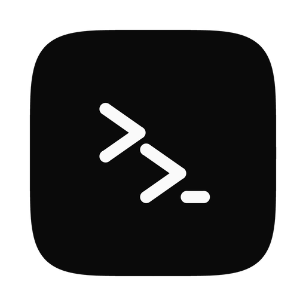

<p align="center">
  
</p>

<h1 align="center">Zorvo</h1>

<p align="center">
  <strong>Every coding agent. One desktop.</strong><br>
  One Mac app for Claude Code, Codex, Qwen Code, Antigravity and the other agents in the
  <a href="https://agentclientprotocol.com">ACP registry</a>, each in a real chat.
</p>

<p align="center">
  <a href="https://github.com/zakyirsyaad/zorvo/releases/latest"></a>
  <a href="https://github.com/zakyirsyaad/zorvo/releases"></a>
  
</p>

<p align="center">
  <a href="https://github.com/zakyirsyaad/zorvo/releases/latest/download/Zorvo-mac.dmg"><strong>Download for Mac</strong></a>
  ·
  <a href="https://zorvolabs.xyz">Website</a>
  ·
  <a href="https://zorvolabs.xyz/docs/">Docs</a>
  ·
  <a href="https://github.com/zakyirsyaad/zorvo/releases">All releases</a>
  ·
  <a href="CHANGELOG.md">Changelog</a>
  ·
  <a href="https://github.com/zakyirsyaad/zorvo/issues/new/choose">Report a problem</a>
</p>

<p align="center">
  
</p>

**New in 0.16:** an agent can put a diagram or a mockup inside its reply,
between the paragraphs of its answer. You can copy it as an image or save it
as SVG, HTML or PNG. 0.15 added a browser beside the chat, a canvas for
several screens side by side, and agents that can look at apps on your Mac
when you let them. From 0.14.1, Zorvo is signed and notarized by Apple, so
macOS opens it like any other app you download. The [changelog](CHANGELOG.md)
has the rest.

> **NEAR hackathon judges:** start with [docs/hackathon/README.md](docs/hackathon/README.md). The
> submitted state is the tag
> [`hackathon-submission`](https://github.com/zakyirsyaad/zorvo/tree/hackathon-submission). The author's
> one other submission, [Foundling](https://github.com/zakyirsyaad/foundling), shares no code, contract
> or service with Zorvo Private.

## Contents

- [Quick start](#quick-start)
- [What you can do](#what-you-can-do)
- [Supported agents](#supported-agents)
- [Requirements](#requirements)
- [Install](#install)
- [Getting started](#getting-started)
- [Privacy and your data](#privacy-and-your-data)
- [Troubleshooting](#troubleshooting)
- [Questions](#questions)
- [Feedback and security](#feedback-and-security)
- [Development](#development)
- [License](#license)

## Quick start

1. [Download **Zorvo-mac.dmg**](https://github.com/zakyirsyaad/zorvo/releases/latest/download/Zorvo-mac.dmg),
   open it, and drag Zorvo into **Applications**.
2. Open Zorvo. macOS asks once whether to open an app you downloaded from the
   internet: click **Open** ([details](#open-zorvo-the-first-time)).
3. On the welcome screen, tick the agents you'll use, press **Install** next to
   any that are not on your Mac (Zorvo brings Node.js or `uv` when an agent
   needs them), pick a project folder and press **Start**.
4. Type your first message. If the agent needs you to sign in, the session
   shows how before you send.

## What you can do

### Work with any agent

<p align="center">
  
</p>

- **The agent's own options.** Zorvo talks to every agent over the
  [Agent Client Protocol](https://agentclientprotocol.com), so you get its real
  models, effort levels, modes and slash commands, including the ones your
  skills and plugins add.
- **An agent catalog.** Settings → Agents lists every agent in the ACP
  registry. Add, install, update and remove agents there.
- **Sign in without leaving the app.** An agent's own login, or its own setup
  (Qwen Code: **Set up Qwen Code**), runs in a terminal inside Zorvo. The
  **Agents** button next to Settings and each row in Settings → Agents say
  whether an agent is ready, needs a sign-in or was not checked yet. An agent
  that needs a sign-in lists its methods under its name, **Check sign-in** is
  in the row's ⋯ menu, and a new session shows a sign-in card before you send.
- **Answer the agent's questions.** When an agent needs an answer from you, it
  can show a form or a question card in the chat, or send you to a web page.
- **Pick up where you left off.** Continue a session you started in an agent's
  own CLI, and sessions resume after a restart.
- **Compare agents.** In a git repository, tick up to four agents at the top
  of the new-session card, choose each one's model beside its name, and send
  one prompt to all of them. Each agent works in its own worktree and uses its
  own quota. One card per agent says how its turn is going, what it changed and
  what it said last; **Pick** keeps one after you confirm. The others stop and
  are archived, and their worktrees stay.

<p align="center">
  
</p>

### Let agents work together

- **Hand a task to another agent.** Start a message with `@Codex` and the
  task, choose **Delegate to another agent** in the session's ⋯ menu, or ask
  the agent in plain words ("then have Qwen Code review it"). The other agent
  works in the same folder, and its answer comes back as a report.
- **You allow it first.** The first time an agent asks to hand off work in a
  session, a card shows who asks, which agent the task is for, the folder and
  the task. **Allow for this session** covers that session's later tasks;
  **Deny** ends the request.
- **Agents can open sessions.** An agent can open a new session from a brief
  it writes: in the same folder, in a worktree of its own, or in another
  folder Zorvo knows, which asks every time. At most three sessions an agent
  opened work at once, and you stay in the session you are in.
- **Follow subagents and commands.** A subagent or a shell command an agent
  started opens as a tab beside the chat. With Claude Code and Qwen Code you
  see a subagent's steps as they arrive.

A private session does not hand work to another agent, since that would send
its conversation outside the TEE.

### Private mode

Private mode is off until you turn it on, and works with Qwen Code.

- **Models inside secure hardware.** Turn on the **Private** chip of a Qwen
  Code draft and the session runs only on NEAR AI Cloud models that run in a
  TEE. A private session never continues on another provider.
- **Checked answers.** Each private reply carries a badge saying whether NEAR
  AI signed every model call behind it, with a link to NEAR AI's Verification
  Center for the hardware proof, which Zorvo does not check itself.
- **Prepaid credits, no account.** Top up in **Settings → Private mode** with
  USDC through PingPay, in your browser. The balance belongs to this Mac, and
  a recovery code moves it to another one. You can also use your own NEAR AI
  key instead.
- **Limits you set.** A draft can cap what its session may spend, and a
  low balance is shown before it runs out.
- **Run by the maintainer.** The credits server is a small service the
  maintainer runs; it never sees a prompt or an answer. Buy small amounts: it
  is new, and it can be out of service.

### Stay in control

- **Approve what the agent does.** Permission requests appear in the chat with
  the agent's own choices, and every new session starts in the safest mode its
  agent offers.
- **See what the agent made, as a page.** An agent can show you a report, a
  diagram or a small dashboard as a web page beside the chat. Ask for a change
  and you get a new version; older versions stay, **Export** saves the page as
  one HTML file, and **Artifacts** in the sidebar lists the pages of every
  session. Press **Comment** above a page to mark text or a part of it, write
  what should change, and add your comments to your next message.
- **A picture inside the reply.** For something small, such as a flow, a
  comparison or a rough layout, an agent can draw it right in its answer. The
  picture follows the light and dark theme. Fold it, **Expand** it, or use its
  menu to copy it as an image or save it as SVG, HTML or PNG. Nothing in it
  runs and it has no links; for a page you can click through, the agent shows
  a page instead.
- **Several screens on one canvas.** For a flow or variants of a screen, an
  agent can lay out artboards in sections on a canvas you pan and zoom.
  Comment on an artboard, **Pick** a variant, ask the agent to **Build this**
  screen in your repository, or **Export** artboards as PNG or PDF. The canvas
  is a folder in your project (`canvas.json` and one HTML file per artboard),
  so git keeps it and deleting the session keeps it.
- **Reply to part of a reply.** Select text in the chat to copy it, or press
  **Reply** to quote it in your next message.
- **A session overview beside the chat.** A card at the top right of the chat
  says where the session works (its changes, its folder, its branch), what is
  running, the files you attached, and the pages and files the agent made. A
  click opens the matching tab, and the card folds to a pill.
- **One inspector beside the chat.** The top bar's **Inspector** button opens a
  panel with five tabs: Changes, Activity, Files, Artifacts and Terminal. Drag its
  edge to resize it; Zorvo remembers the width.
- **See what an agent did.** The Activity tab lists, turn by turn, the files it
  reported, the commands it ran and the permissions you answered, and shows
  files git says changed that it did not report. It is the agent's own report,
  and it says so.
- **See every change.** The Changes tab shows each changed file with its counts
  and diff, and lets you commit the files you choose. The full diff review opens
  in the chat's place, with the files listed on the left.
- **Comment on lines of a diff.** Leave comments on the lines an agent changed,
  in the Changes tab or the full review, add them to your message, read or edit
  it, and send it. The agent gets each comment with its file, its line and the
  line itself. A comment that no longer matches its line says **Outdated**
  instead of moving to another one.

  <p align="center">
    
  </p>

- **Know when an agent is stuck.** If an agent reports failed requests, or has
  sent nothing for a minute, Zorvo says so under **Working…**, with a Stop
  button. If the agent has not stopped ten seconds after **Stop**, **End
  agent** ends its process.
- **Follow your pull request.** The session's card and its row in the sidebar
  show the branch's pull request and how its checks stand, read with your own
  `gh`.
- **Connect to GitHub.** **Settings → GitHub** shows whether your
  GitHub CLI is installed and signed in. If it is not signed in, **Connect**
  opens a terminal where `gh` signs you in through your browser; `gh` asks a few
  questions there, such as which Git protocol you use, and you answer them in
  the terminal. Once you are connected, the sidebar shows your GitHub name
  instead of your git name.

### Keep your work organized

- **Sessions by folder.** Sessions are titled from your first message and saved
  on your Mac. Each row says in words what its agent is doing ("Working",
  "Waiting for you", "Finished, unread"). Rename, pin and archive them, or open
  one in its own window. **Hide sidebar** gives the chat the whole window.
- **Fork and rewind.** Fork any reply into a new session, or rewind to before
  one of your messages and send it again, edited.
- **Worktrees.** Run a session in its own git worktree on an `agent/<title>`
  branch, so agents in the same repository never edit the same files.
- **A terminal where the agent works.** The inspector's **Terminal** tab opens
  a shell in the session's folder, with a tab per shell. Shells keep running
  when you switch tabs or close the inspector.
- **Read a file without leaving Zorvo.** The **Files** tab marks changed files
  and opens a file with its changed lines marked. Select lines to add them to
  your message. Images and PDFs open there too.
- **A composer that knows your project.** Mention files with `@`, run the
  agent's commands with `/`, and drop files or pictures onto the window, or
  paste a screenshot.
- **See what fills the context.** Click the context meter under the message
  box to open the Context tab: how full the agent's context is, what is left,
  what the session cost, and how it grew turn by turn. Qwen Code reports what
  fills it; for other agents Zorvo estimates and marks each value with ~.

## Supported agents

Zorvo lists every agent in the [ACP registry](https://agentclientprotocol.com)
and runs the ones it can verify: a download needs a published SHA-256 checksum,
and a package must be pinned to one version. Agents that fail that check appear
under **Not available** in **Settings → Agents**, with the reason.
**Claude Code, Codex and Qwen Code** are on by default, along with any registry
agent already installed on your Mac. Add the others, such as Antigravity, from
**Settings → Agents**.

Every agent works the same way in Zorvo: its own models, effort and modes,
approvals in the chat, fork and rewind. A session continues after a restart
when its agent can resume or reload sessions; an agent that cannot says so.

A new version of an agent is offered as soon as the ACP registry lists it,
and never one the registry has withdrawn.

## Requirements

- **A Mac** with Apple Silicon or Intel.
- **Node.js 22 or newer** for the agents that come as npm packages (Claude
  Code, Codex, Qwen Code and many others). If yours is missing or older, Zorvo
  installs its own when you install such an agent. Zorvo installs the agent's
  package into its own folder with `npm` and starts it from there, so starting
  a session downloads nothing.
- **An account with at least one agent.** Each agent signs in with its own
  tools; Zorvo never asks for your API keys.

  | Agent | Sign in | Optional global install |
  |---|---|---|
  | Claude Code | The sign-in panel in Zorvo, or `claude` then `/login` | `npm i -g @anthropic-ai/claude-code` |
  | Codex | The sign-in panel in Zorvo, or `codex login` | `npm i -g @openai/codex` |
  | Qwen Code | **Set up Qwen Code** in a new session, or run `qwen` once in a terminal | `npm i -g @qwen-code/qwen-code` |

  A global install is not needed; it only makes an agent show up as installed
  before you first use it.
- **Optional: the [GitHub CLI](https://cli.github.com)**, signed in with
  `gh auth login` or with **Connect** in **Settings → GitHub**, to see pull
  requests and their checks and to show your GitHub name in the sidebar.

Zorvo reads your login shell's environment, so it finds whatever your terminal
finds. If you install an agent while Zorvo runs, click **Check again** in
Settings → Agents.

## Install

### Download

Download [**Zorvo-mac.dmg**](https://github.com/zakyirsyaad/zorvo/releases/latest/download/Zorvo-mac.dmg)
from the latest release. One file works on both Apple Silicon and Intel Macs.
Open it and drag **Zorvo** into **Applications**.

Or install it with [Homebrew](https://brew.sh):

```bash
brew install --cask zakyirsyaad/tap/zorvo
```

### Open Zorvo the first time

From 0.14.1, Zorvo is signed with a Developer ID and notarized by Apple. The
first time you open it from Applications, macOS asks whether to open an app you
downloaded from the internet. Click **Open**; from then on it opens without
asking.

Versions before 0.14.1 are not signed, and macOS blocks them. Install the
latest release instead. If you need an older one, open it once, then go to
**System Settings → Privacy & Security** and click **Open Anyway** next to the
message about Zorvo.

### Check your download

Each release lists the SHA-256 checksum of its DMG in `SHA256SUMS.txt`.
Download it into the folder with the DMG, then run this in that folder:

```bash
shasum -a 256 -c SHA256SUMS.txt --ignore-missing
```

`Zorvo-mac.dmg: OK` means you have the exact file the release published. Only
download Zorvo from this repository's
[releases](https://github.com/zakyirsyaad/zorvo/releases).

### Update

From 0.6.0 on, Zorvo tells you when a newer version exists: a card in the bottom
right of the window says "Zorvo X.Y.Z is ready". Click **Update & restart** and
Zorvo downloads the update, checks its signature, installs it and opens again.
**Later** hides the notice until you next start Zorvo. Agents that are working
stop, and open terminals end, when Zorvo restarts; the card says how many, so
update when the agents are idle and nothing runs in a terminal. Your sessions
are kept: they are stored outside the app. **Settings → General** shows when
Zorvo last checked, with **Check now**.

A copy that runs from the disk image, or from any other read-only place, cannot
update itself there: drag Zorvo into Applications, open it from there, and
update again.

Updating from 0.14.0 or earlier to 0.14.1 or later changes how Zorvo is signed,
so macOS treats it as a new app once. It may ask again for access to your
folders, and Private mode may ask once to use its items in your Keychain:
choose **Always Allow**. After that, updates keep your permissions.

Copies older than 0.6.0 cannot update themselves. Update those once by hand:
download the newest DMG and replace Zorvo in Applications. The same works if an
update ever fails and you would rather not retry.

### Uninstall

Quit Zorvo and move it from Applications to the Trash. To remove your data as
well, delete `~/Library/Application Support/xyz.zorvo.desktop/`. It holds your
sessions, their worktrees and the agents Zorvo installed.

### Coming from Agent Desktop

Zorvo is installed next to the old Agent Desktop app and copies its sessions on
first launch. Then delete Agent Desktop from Applications: both apps share the
old sessions' worktrees, so deleting a session in one would remove its worktree
in the other. macOS asks again for notification and folder permissions.

## Getting started

1. **The welcome screen.** The first run lists the agents in use or on your
   Mac, then the popular ones. Tick the ones you'll use, install any that are
   missing, pick a project folder and press **Start**. **Settings → General →
   Run setup again** brings it back.
2. **Start a session.** Click **New session**, or the **+** next to a folder.
   On the card, tick the agent at the top and pick its model beside it, type
   your task, and choose the folder and the branch at the bottom (or **New
   worktree** to give the session its own checkout). Then press **Start**.
3. **Work with the agent.**
   - Answer its permission requests and questions in the chat.
   - Open the **Inspector** to review and commit changes, follow its activity,
     read files and run a terminal in the same folder.
4. **Branch off.** Point at a message to see its actions.
   - **Fork** under any reply starts a new session from there.
   - **Rewind** under one of your messages takes the conversation back to
     before it and puts the message in the composer to edit. Files the agent
     changed stay as they are.

Each session starts in the safest permission mode its agent offers (its
**Default**, **Manual**, **Ask** or **Read-only** mode), so the agent asks
before it edits files or runs commands. Pick another mode in the composer.

## Privacy and your data

- **Your keys stay with the agents.** Zorvo never asks for or stores API keys
  or tokens. Agents sign in with their own tools, and pull request data comes
  from your own `gh` login. The one exception is Private mode, which you turn
  on yourself: Zorvo then keeps this Mac's credits secret, the NEAR AI key
  its private Qwen Code sessions use, and a capped session's own key in your
  macOS Keychain. If you paste your own NEAR AI key in Settings, Zorvo keeps
  that in the Keychain too, after NEAR AI has checked it. A key never enters
  the agent: each private launch gets a one-time token for a loopback proxy in
  Zorvo's backend, which adds the key and forwards the agent's model requests
  to NEAR AI.
- **Private sessions get a small local MCP server.** It ships in Zorvo's app
  bundle and answers the agent's `credits_balance` and `private_models` calls
  by reading Zorvo's loopback proxy with that session's one-time token. It
  never sees the NEAR AI key or this Mac's credits secret, and it contacts no
  host of its own.
- **A local secret check before private messages.** When you send in a private
  session, Zorvo looks for keys and passwords in the message and its attached
  files on this Mac. Nothing goes out until you choose Send anyway or Edit
  message, and a match is never stored. Settings → Private mode turns the
  check off.
- **GitHub stays in your `gh`.** Zorvo asks your `gh` whether you are signed in
  to github.com and reads only your login and name, to show them in the sidebar
  and in Settings. It stores neither, never reads or keeps a token, and
  downloads no picture. **Connect** runs `gh auth login` for github.com in a
  terminal, and you sign in through your browser.
- **Agents start other agents only after you allow it.** An agent can ask
  Zorvo to give another agent a task. The first time in a session, Zorvo shows
  you who asks, which agent the task is for, the folder and the task itself;
  after **Allow for this session**, that session's agent can give further tasks
  without asking again, until you close Zorvo or choose **Stop allowing
  delegation** in the session's menu. The other agent works in the same folder
  and its answer is sent back. An agent can also open a new session from a
  brief it writes; in another folder Zorvo knows, that asks every time and is
  allowed once, never in advance. You can turn all of this off in
  **Settings → Agents**.
- **A page an agent shows you is kept apart.** An agent can make a web page
  and show it in the **Artifacts** tab. The page runs in a part of the window
  of its own: it cannot call Zorvo, read your files, keep data, or open any
  address but its own. It may load scripts from `cdnjs.cloudflare.com`,
  `cdn.jsdelivr.net`, `unpkg.com`, `cdn.tailwindcss.com` and `code.jquery.com`
  and fonts from Google Fonts (`fonts.googleapis.com`, `fonts.gstatic.com`),
  and only when the page asks for them; it cannot send a request anywhere
  else. Those hosts see that a file was asked for, as any website's would.
  Zorvo's own interface still makes no request at all. Pages are stored on
  this Mac and deleted with their session. A page you **Export** is an
  ordinary HTML file: opened in a browser, it has none of these limits.
- **A picture in a reply reaches no host.** Zorvo removes scripts and links from
  a picture before it is shown, and draws it in a frame that cannot run code
  or load anything from the network: an image in it must be part of the
  picture itself. Pictures are stored on this Mac and deleted with their
  session. A picture you save as HTML keeps these limits when opened in a
  browser, and one you save as SVG has its outside addresses taken out.
- **A canvas reaches no new host.** Each artboard of a canvas runs under the
  same limits as a page, and may load the same script and font hosts, plus
  the files in its own canvas folder. Zorvo's frame around the artboards
  loads nothing from the network. The canvas stays in your project folder;
  Zorvo keeps only a list of the canvases a session showed and pictures of
  the artboards on this Mac, and removes a picture no canvas has used for 30
  days.
- **No telemetry.** Zorvo sends nothing about you or your work anywhere.
- **Browser pages.** The Browser inspector loads the HTTP(S) pages you or your agent choose, and their subresources, in a separate WebKit view. Submitted address-bar search text goes to Google. The chat's own webview keeps its network restrictions. Each session has an in-memory browser store; different sessions do not share it. Agents need a browser session grant, and file uploads need a separate destination/files approval. Chromium debug opens an isolated Chrome or Brave window; its tabs and cookies are separate from WebKit. Optional Lighthouse tools are installed from npm with a pinned integrity lockfile after you click Install audit tools; an audit uses a fresh Chromium profile and a temporary loopback debugging endpoint.
- **Other connections, all named.** Outside the browser pages, Zorvo itself contacts only:
  - the ACP registry (`cdn.agentclientprotocol.com`), to list agents, their
    versions and their logos;
  - an agent's download URLs from the registry, when you install a binary
    agent;
  - `nodejs.org`, when you install an agent that needs Node.js and yours is
    missing or older than 22;
  - `uv`'s releases on GitHub, when you install an agent that runs with `uvx`
    and you have no `uvx`;
  - the Zorvo Credits server (`zorvo-credits-server.zkyxentertain.workers.dev`),
    only for Private mode: once you open Settings →
    Private mode or turn on a draft's Private chip, and then at start to read
    your balance and to follow a top-up still waiting from before. It sees this
    Mac's credits, never your prompts or code;
  - NEAR AI Cloud (`cloud-api.near.ai`), only while a private session runs: the
    loopback proxy forwards the agent's model requests there with the key.
    Prompts go straight to NEAR AI; the Credits server never sees them. At a
    turn's end Zorvo also asks NEAR AI what that turn's calls cost, with the
    session's key; when billing cannot answer, it estimates from token counts;
  - this repository's releases on GitHub, to ask whether a newer Zorvo exists
    (`github.com/zakyirsyaad/zorvo`, shortly after Zorvo starts, then
    about once a day) and, when you click **Update & restart**, to download it
    (`api.github.com`). GitHub sends both requests on to its download host,
    today `release-assets.githubusercontent.com`. The check sends no
    information about you or your work.

  No agent, runtime or Zorvo update downloads until you click **Install**,
  **Update** or **Update & restart**, with one exception: when Zorvo opens, an
  agent you have used (it has a session, is your default, or was seen signed
  in) whose npm package is not in Zorvo's folder yet is installed without a
  click, once (this is how agents from before 0.13 move over). An agent you
  never used is not downloaded until you click **Install**.

  Runtime and binary agent downloads are checked against a SHA-256 hash pinned
  in advance. An agent that comes as an npm package is installed by `npm` at
  the exact version the registry pins, with npm's own integrity check. A Zorvo
  update must come from this repository's releases and is installed only if
  its signature matches the key built into Zorvo.

  Your agents, the `npm` that installs them and the `uvx` some run with make
  their own requests to their own services. So does your `gh`, which Zorvo
  runs to read your pull requests and your GitHub sign-in.
- **Your data stays on your Mac.** Sessions and transcripts are stored in
  `~/Library/Application Support/xyz.zorvo.desktop/`, and session worktrees in
  `worktrees/` there.
- **Only the folders you open.** Zorvo reads and runs commands only in folders
  you opened in the app.

## Troubleshooting

| Problem | What to try |
|---|---|
| macOS blocks Zorvo on first open | Zorvo 0.14.1 and later only asks once, with **Open**. A copy macOS still blocks is an older version, or one that did not come from this repository's [releases](https://github.com/zakyirsyaad/zorvo/releases); see [Open Zorvo the first time](#open-zorvo-the-first-time). |
| An agent shows as not installed | Click **Install** next to it in Settings → Agents, or pick it in a new session's agent list and click **Install**. Zorvo brings Node.js or `uv` when the agent needs them. Then click **Check again**. |
| "Sign in to *agent*" | Use a sign-in method the panel offers, or sign in once in a terminal (see [Requirements](#requirements)). If you set a key outside Zorvo (for example in `~/.zshrc`), click **Check again** in the panel: Zorvo reads your shell's settings again, then asks the agent. Your refused message waits in the box and is sent once you are signed in. |
| **Update & restart** fails with a read-only message | A copy that runs from the disk image cannot update itself: drag it into Applications and open it from there. Or download the newest DMG from [releases](https://github.com/zakyirsyaad/zorvo/releases) and replace Zorvo in Applications. |
| The welcome screen says "Zorvo could not read your agents" | Press **Check again**. Zorvo reads your login shell's environment to find your agents, so if it keeps failing, check that a new terminal window opens without errors, then quit and reopen Zorvo. |
| GLM Agent asks you to sign in, or reads **Not checked** | It needs `Z_AI_API_KEY` in your shell. Export it in `~/.zshrc` (or run the agent's own setup), then click **Check again**. Zorvo only checks that the variable is set, never its value. |
| An agent's row says **Installing** after an update | Zorvo installs the package of each agent you have used, once, in the background. The agent can start a session when its row stops saying Installing. |
| The agent keeps working after **Stop** | Stop asks the agent to end its turn. If it has not stopped after ten seconds, the chat offers **End agent**, which ends the agent's process. You can continue the session afterwards. |
| The agent stays on **Working…** | If Zorvo shows that the agent's requests failed, the cause is usually the agent's account, such as a used-up quota. Check it in the agent's own CLI, then click **Stop** and send your message again. |
| No pull request status | Open **Settings → GitHub**. If `gh` is not installed, install it; if you are not connected, click **Connect**. A repository without a GitHub remote has none to show. |
| "is not in the last commit, so a worktree would not have it" | A worktree checks out the last commit. Commit the folder first, or pick a branch instead of **New worktree**. |

Still stuck? [Open an issue](https://github.com/zakyirsyaad/zorvo/issues/new/choose)
with your Zorvo version, shown in **Settings → General**.

## Questions

**Does Zorvo need my API keys?** No. Each agent signs in with its own tools,
and Zorvo never asks for or stores keys or tokens.

**Does it work on Windows or Linux?** Not yet. Zorvo is a Mac app for now.

**Is the source code available?** Yes. It is in this repository, under the
Apache License 2.0.

**Which agent should I start with?** The one you already use. Zorvo shows each
agent's own models and modes, so it works the way that agent does, next to the
others.

## Feedback and security

- **Found a problem or have an idea?**
  [Open an issue](https://github.com/zakyirsyaad/zorvo/issues/new/choose).
  Never paste API keys, tokens or other secrets into an issue.
- **Found a security problem?** Report it privately, as described in
  [SECURITY.md](SECURITY.md), not in a public issue.

## Development

Zorvo is a Tauri 2 app with a React frontend and a Rust backend.
[docs/development.md](docs/development.md) covers how it works, the checks and
the release process, and [CONTRIBUTING.md](CONTRIBUTING.md) covers how to send a
change.

## License

Zorvo is open source under the [Apache License 2.0](LICENSE).
The license does not cover the Zorvo name or logo.
