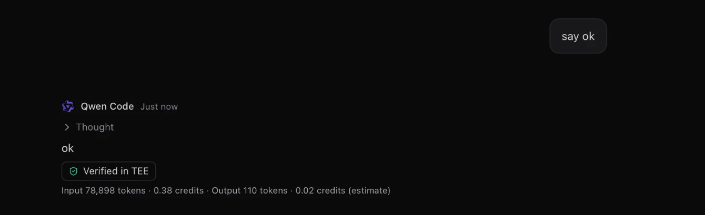
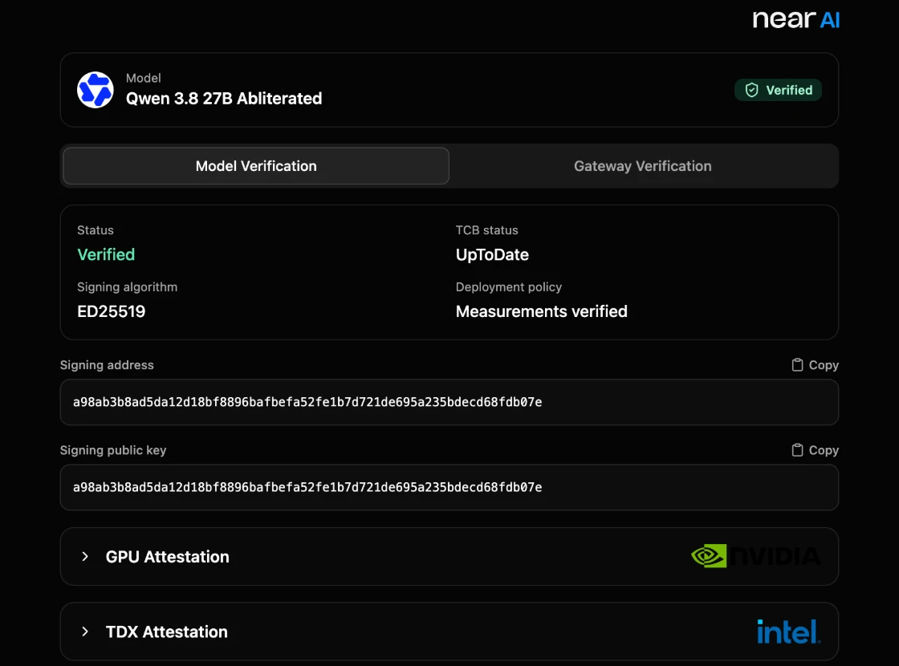

# NEAR HACKATHON: Zorvo Private

Tracks: `privacy` (primary), `security`, `open`, `agents`. Branch: `hackathon/near-credits` (tag `hackathon-submission`), also on `main` since Zorvo 0.12.0.

Paths below are from the repository root.

Zorvo Private is an opt-in private mode in Zorvo, an open-source macOS app that hosts coding agents over
the Agent Client Protocol (ACP). In Private mode Qwen Code runs only on NEAR AI Cloud models that run
inside a TEE (Intel TDX with NVIDIA confidential computing), not on the user's own account or an
ordinary cloud endpoint. The user pays with prepaid credits bought with USDC through PingPay. There is no
sign-up, wallet or email: the balance belongs to the Mac, and a recovery code moves it to another Mac.



_A private reply on 2026-11-14: NEAR AI's signature checked, and what the reply used._



_The badge's link opens NEAR AI's Verification Center on the session's model: the hardware check Zorvo does not run itself._

## Role of NEAR

- **Private compute.** Models run in NEAR AI Cloud TEEs (Intel TDX + NVIDIA confidential computing). The
  app offers only models NEAR AI marks `verifiable: true`; a model that stops being verifiable leaves the
  list, and a private session is never silently continued on a non-TEE provider.
- **Signed answers.** Each private answer is checked against NEAR AI's signature over the exact request
  and response bytes, and the signer is checked against NEAR AI's attestation report. Zorvo does **not**
  do a DCAP or NRAS hardware check; it verifies the signature and the report's signer address, and links
  to NEAR AI's Verification Center for the hardware proof itself. A streamed answer is usually signed by
  NEAR AI's gateway rather than the model's provider key.
- **The key stays local after handover.** The Credits Worker creates one NEAR AI key per Mac and stores it
  encrypted for at most 24 hours, until the app collects it; after that the app keeps it in the macOS
  Keychain, and a loopback proxy in Zorvo's Rust backend adds it to each request. Qwen Code only ever holds
  a one-time proxy token. The Worker never sees prompts or completions. A capped session's key is created
  the same way, handed to the app once, and not stored by the Worker.
- **USDC on NEAR.** Payments are USDC on NEAR through PingPay, which is built on NEAR Intents. Zorvo
  creates a checkout on the Credits Worker and opens it in the browser; no card or wallet data reaches
  Zorvo. The checkout return URLs in `server/wrangler.jsonc` point at this branch's `server/README.md`, so
  a redeploy follows a branch rename.
- **Spend-limited keys.** The Worker creates one NEAR AI key per Mac with a spend limit, and the
  per-session cap creates a second key with its own limit. NEAR AI's gateway enforces both (`402`), so a
  cap holds even if Zorvo is closed.
- **Operator login.** The operator signs in to NEAR AI with NEP-413 through
  `server/scripts/operator-login.mjs`; the operator's full-access NEAR key stays on the operator's Mac.

## Tracks

- **`privacy` (primary).** Prompts go from the agent to NEAR AI through the local proxy; the Credits
  Worker never sees a prompt or a completion. It creates the Mac's NEAR AI key and hands it over once, as
  described above; after collection the key lives in the macOS Keychain, not in the Worker. Nothing
  prompt-shaped is kept server-side: the Worker stores no prompts or completions, and the loopback proxy
  keeps only completion ids and SHA-256 hashes in memory for the app run.
- **`security`.** Every completed private answer is checked against NEAR AI's signature over the exact
  request and response bytes, and its signer against NEAR AI's attestation report. Zorvo does not run a
  DCAP or NRAS hardware check; it verifies the signature and the report's signer address and links to
  NEAR AI's Verification Center for the hardware proof. The NEAR AI key never enters Qwen Code's process:
  a loopback proxy in Zorvo's Rust backend holds it and adds it to each request, while the agent holds
  only a per-launch proxy token. Spending caps are enforced by NEAR AI's gateway (`402`), not by Zorvo,
  and the device key's limit is kept at what the Mac bought minus its open caps and spent credits, so the
  device's total can never pass what it bought. Before a private message leaves, a local secret check
  looks for keys and passwords in its text and attachments and pauses Send until you choose; nothing it
  finds is stored or sent.
- **`open`.** Zorvo and the Credits Worker are in this Apache-2.0 repository. The Worker is a plain
  Cloudflare Worker with one SQLite Durable Object; its contract, operator setup and deploy steps are in
  [`server/README.md`](../../server/README.md). Outside Private mode, no API keys are stored in the app; Private
  mode keeps its keys in the macOS Keychain.
- **`agents`.** A coding agent spends prepaid credits on private compute through its own spend-limited
  NEAR AI key. The key's limit is enforced by NEAR AI's gateway (`402`), and a session can also carry a
  100, 200 or 500-credit cap of its own. An MCP server inside the app lets the agent read its balance and
  the model prices; it never sees the key or the device secret. It can also ask the user for a top-up,
  with one short reason: the card shows the Worker's package and credits, and only the user's click
  starts their own PingPay checkout. Payment is USDC on NEAR through PingPay (NEAR Intents).

## Reproduce

### (a) No Mac needed

1. `pnpm install` → installs the workspace, including `server/`.
2. `pnpm --filter zorvo-credits-server test` → **406 Vitest tests and 31 Node tests pass**. The suite
   prints two expected uncaught-exception lines from its own tests and still exits 0.
3. `curl -s -o - -w '\n%{http_code}\n' https://zorvo-credits-server.zkyxentertain.workers.dev/v1/models`
   → `{"error":"unauthorized"}` and `401`: the live Worker is up and refuses a request without a device
   secret.
4. With a judge code, Node 20 or newer:
   `node server/scripts/judge-demo.mjs https://zorvo-credits-server.zkyxentertain.workers.dev JUDGE-64cb8c2fa0b4`
   → `Model: Qwen/Qwen3.8-27B-abliterated`, `Kind: provider_tee` (or `gateway`), `Signer: 0x…`, and
   `Verified: NEAR AI signed the exact request and response, and its attestation names the signer.`
   The script registers a fresh device, redeems the code, waits for the credit, checks that the Worker
   offers the judge model, sends one non-streamed completion, hashes the exact bytes, and checks the
   signature and attestation report. It never prints the code, the device secret or the key. It asks for
   `Qwen/Qwen3.8-27B-abliterated` — the abliterated variant, whose safety refusals are removed for this
   demo — so that model must be in the Worker's `MODELS` allowlist and deployed; if it is absent the script
   says the Worker does not offer it instead of failing at the model call.

### (b) On a Mac

Use a Mac with Apple Silicon or Intel; the product's [Requirements](../../README.md#requirements) sets no separate macOS
floor, and its Install notes cover macOS 15 and later. Before the first build: Xcode Command Line Tools
(`xcode-select --install`), Rust through rustup, Node from `.nvmrc` (26; 22+ also runs), and pnpm 12
(`corepack enable`). The first `pnpm tauri dev` compiles the Rust backend and takes roughly 10–20 minutes
on a cold cache; later builds are much faster.

1. `git clone --branch hackathon/near-credits https://github.com/zakyirsyaad/zorvo.git`
2. `cd zorvo && pnpm install`
3. `ZORVO_CREDITS_URL=https://zorvo-credits-server.zkyxentertain.workers.dev pnpm tauri dev`
4. In Settings → Private mode, paste the judge code under **Promo code** and press **Redeem** → the
   promo row says `N credits added. Enjoy.` and the key line says `Key ready`.
5. Add `examples/private-demo` as a workspace, start a Qwen Code draft with the **Private · TEE** chip
   on, and send **"Review the payment module for client Acme and list what could leak card data."** →
   Qwen answers from NEAR AI; the reply carries **Verified in TEE**, and its popover shows the model,
   the signer and the Verification Center link. The folder is fictional and needs no real data; its
   README lists the three planted problems.
6. Optional: set **Session limit** to 200 credits in the draft → the composer shows
   `N of 200 credits this session`, and the Private inspector shows the same with a progress bar.
7. Paste an AWS-looking key in the prompt (or attach a `.env` with one) → Zorvo holds the message, names
   the match, and sends nothing until **Send anyway** or **Edit message**. The check runs on this Mac; no
   match is stored or sent.
8. Settings → Private mode → **Add key** saves your own NEAR AI key from an organization with credits;
   under **Private sessions pay with**, pick **My NEAR AI key**, then start a private session: the
   footer says `Paying with your NEAR AI key`, priced in dollars instead of Zorvo credits.
9. The Private inspector shows **This session** usage and its **Average per turn**; Settings → Private
   mode lists the total **Used by N models** and the turns each model's price leaves.

The judge code is `JUDGE-64cb8c2fa0b4`: 10 credits, 10 uses in all, one per device (8 left on 2026-11-14: two went to checking the judge script, the second of which printed `Verified`). Measured live, a short
turn of Qwen Code costs about 0.4 credits (its system prompt is large: one "say ok" sent about 79,000
input tokens over several model calls), so one redemption is about 20 short turns. The top-up packages
show **Not enough stock right now** while the judge code holds the stock: the operator funded only
about $2 of NEAR AI credit for the hackathon. Redeeming the code is the path to try.

## Attack demo

Four things a private session can try, and what stops each. Run them after the Mac steps above.

**(a) The agent prints its key.** In a private session, send: "Run `printenv OPENAI_API_KEY`." Qwen
prints a 64-character hex string. That is a per-launch proxy token, not a NEAR AI key; it names one
session and one model. Send it straight to `https://cloud-api.near.ai/v1/chat/completions` as a bearer
token → `401`. The real NEAR AI key stays in Zorvo's loopback proxy and never enters the agent's process.

**(b) The token reaches past its session.** Print the proxy URL with `printenv OPENAI_BASE_URL`. With
the same token, send a completion whose `model` is another id → `400`; request a path the proxy does
not serve, such as `/v1/embeddings` → `404`. The Rust tests that prove this are
`private_proxy_test::refuses_a_missing_unknown_or_released_token_without_forwarding` and
`private_proxy_test::refuses_another_model_and_other_paths_without_forwarding`.

**(c) A session hits its cap.** Start a session on the 1-credit promo, or set a 100-credit cap and use
it up → NEAR AI answers `402`, Qwen stops, and the composer shows the cap card. The limit is enforced
by NEAR AI's gateway, not by Zorvo, so it holds even if Zorvo is closed.

**(d) A secret goes into a message.** Assemble a fake AWS-shaped key by concatenating `AKIA` and
`0000000000000000` (four letters and sixteen zeros, not a real key), then paste it into a private
prompt → Zorvo holds the message and names the match before anything leaves this Mac. Choose **Send
anyway** or **Edit message**; nothing the check finds is stored or sent.

Log lines from the live run on 2026-11-14 (`wrangler tail` on the deployed Worker; no key, token, device
secret or prompt is in them):

```text
# before the fix in 8740804: NEAR AI binds a refresh token to the login's User-Agent
(error) Alert refresh_failed: operator token refresh failed: NearAiError: NEAR AI POST /users/me/access-tokens failed with 401

# after it: the operator session refreshes and the stock is read
Alarm @ 11/14/2026, 11:43:58 AM - Ok
  (error) Alert low_stock: 200 credits left to sell

# a promo code redeemed, credited by the next alarm, and the device's key collected once
Ledger.redeemPromo - Ok @ 11/14/2026, 11:45:20 AM
POST https://zorvo-credits-server.zkyxentertain.workers.dev/v1/promo - Ok @ 11/14/2026, 11:45:20 AM
Alarm @ 11/14/2026, 11:45:58 AM - Ok
Ledger.takeKey - Ok @ 11/14/2026, 11:45:59 AM

# private turns followed: the Worker saw only balance and stock reads, never a chat request
GET https://zorvo-credits-server.zkyxentertain.workers.dev/v1/balance - Ok @ 11/14/2026, 11:46:41 AM
GET https://zorvo-credits-server.zkyxentertain.workers.dev/v1/stock - Ok @ 11/14/2026, 11:47:15 AM
```

In the app the same run showed `30 credits`, `Key ready`, a Qwen Code answer on
`Qwen/Qwen3.8-27B-abliterated` with **Verified in TEE**, and under it
`Input 78,898 tokens · 0.38 credits · Output 110 tokens · 0.02 credits (estimate)`. The 402 of attack
demo (c) was not captured live.

## Hardware proof

Zorvo checks NEAR AI's signature and the signer's address in NEAR AI's attestation report. It does not
run the DCAP/NRAS hardware check itself; NEAR AI's own verifier does. With your own NEAR AI key in the
`API_KEY` environment variable, follow
[`nearai/nearai-cloud-verifier`](https://github.com/nearai/nearai-cloud-verifier) (Python 3.10+ or
Node 20+), then run one of these from that repository:

```bash
python3 py/model_verifier.py --model Qwen/Qwen3.8-27B-abliterated
pnpm run model -- --model Qwen/Qwen3.8-27B-abliterated
```

Compare the `signing_address` it reports with the signer in Zorvo's **Verified in TEE** popover, or
with the `Signer:` line from `server/scripts/judge-demo.mjs`. The same address means the key whose
signature Zorvo checked is bound to the TDX quote and NVIDIA evidence that the verifier validated.
This is the check Zorvo itself does not run.

## What existed before, and what the window added

Zorvo predates the hackathon: it is an open-source macOS app that hosts ACP coding agents, and it is not
on another chain. Everything under Private mode, `server/`, the loopback proxy, signature and attestation
verification, the credits UI, the own-key path, the secret guard, per-session usage and the per-session
cap was built from 2026-11-07 onward on this branch. The comparison is
[`pre-hackathon...hackathon-submission`](https://github.com/zakyirsyaad/zorvo/compare/pre-hackathon...hackathon-submission).
Both tags are created at submission; until then the compare link has nothing to show.

## Disclosures

- **Main libraries.** Cloudflare Workers + Durable Objects, hyper, reqwest, rustls with ring,
  rustls-platform-verifier, k256, sha3, Tauri and React. The judge script uses `@noble/curves` and
  `@noble/hashes`.
- **AI-assisted code.** Parts of this branch were written with Claude Code and Qwen Code under the
  author's direction and review; the author reviewed and tested every change.
- **Other projects by the author.** One other submission to this hackathon, independent of this one:
  [Foundling](https://github.com/zakyirsyaad/foundling), a USDC vault on NEAR whose strategy runs sealed
  in an OutLayer TEE. It shares no code, contract or service with Zorvo Private.

## Security and privacy model

- Prompts and completions go from Qwen Code to NEAR AI; the Credits Worker never sees them.
- The NEAR AI key is created by the Credits Worker and handed to the app once, stored encrypted in the
  Worker only until collection (at most 24 hours); after that it lives in the macOS Keychain and the
  backend's loopback proxy. The agent gets a one-time proxy token; the device secret, an own key and a
  capped session's key live in the Keychain, and no secret is logged or sent to the webview. The Worker
  never sees prompts or completions.
- The Worker stores hashes of device and promo codes, NEAR AI key ids, encrypted operator tokens, and a
  user key only encrypted for at most 24 hours until it is collected. A leaked database has no usable key
  or device secret.
- PingPay webhooks are accepted only with a valid, fresh HMAC signature; the admin route compares its
  token in constant time.
- Answer verification checks NEAR AI's signature over the exact bytes and the signer in its attestation
  report. It is not a DCAP/NRAS hardware verification; that proof is at NEAR AI's Verification Center.

## Known limits

- The operator restocks NEAR AI by hand; credits are custodial and non-refundable.
- Not run live: a real PingPay top-up through the app (the stock went to the judge code), and the 402
  of a spent cap. The top-up path is covered by tests only.
- PingPay's hosted checkout failed on its Solana path on 2026-11-14 ("Payment failed: Buffer is not
  defined", in two browsers); paying with USDC on NEAR worked.
- A reply made of several model calls can be signed by more than one NEAR AI signer; the popover then
  says so instead of naming one. NEAR AI's Verification Center page checks a model's deployment, not one
  reply, so the badge's link opens it on the session's model.
- The composer's "about N turns" overstates what a balance buys with Qwen Code, whose turns send far
  more input than the estimate assumes; the line under each reply shows what that reply used.
- Signature records live in memory: a reply made before the app was restarted keeps the badge it had
  and gets no new one.
- Qwen Code is the only agent that can run privately for now, and Zorvo is macOS only.
- No DCAP/NRAS check in Zorvo. Streamed answers are usually gateway-signed; an answer cut off before it is
  signed reads **Not signed**. The live NEAR AI signature and attestation shapes are confirmed at M5; the
  repo's tests use fixtures until then.
- A signed session is not a guarantee of model quality or of the provider's policy; it proves which
  hardware key signed the bytes.
- The Worker is hosted for the hackathon through 2026-11-25. If it is unreachable, the balance is
  unavailable and running private sessions keep working while their credits last.

---
